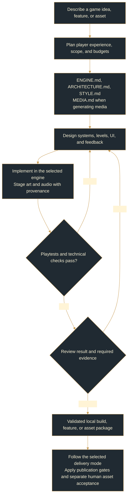
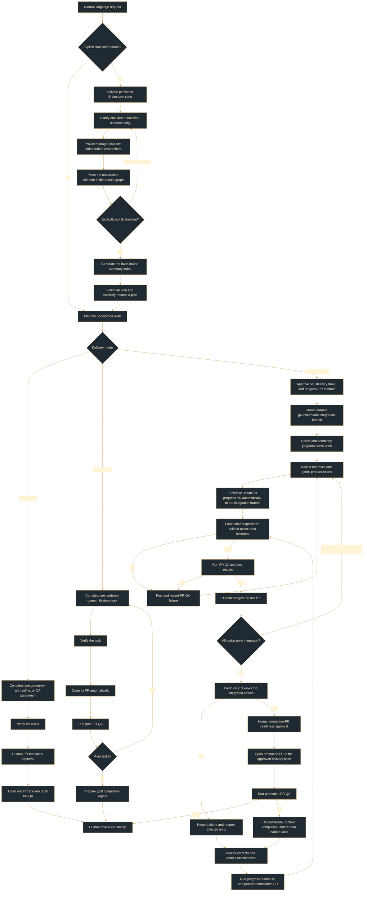
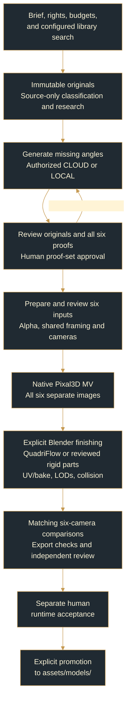
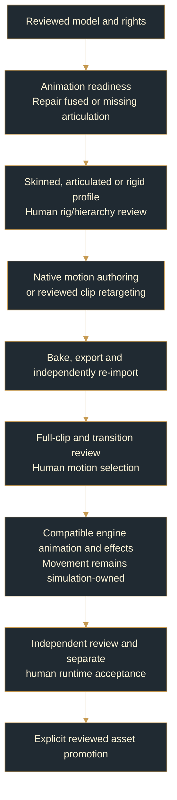

# Hephaera


**Hephaera is a shared AI production baseline for video game development.** Describe the game, feature, or asset you want in ordinary language, refine the plan together, and work with your coding agent through design, implementation, playtesting, and review.

```text
Help me build a small playable vertical slice of this action RPG. Start with movement, one enemy, a readable combat HUD, and one reviewed environment prop. Inspect the project, agree on scope and performance targets, then plan the work before editing.
```

Hephaera brings game-design methods, engine-specific skills, art and audio workflows, QA, and delivery controls into **Codex, Claude, Cursor**, and other compatible agents. You can begin with a conversation; roles, skills, and commands are optional ways to make a request more precise.

Hephaera's wordmark pairs Bubo's robotic owl with matching [charcoal, slate and gold branding](docs/BRANDING.md).



Each game project installs Hephaera in `.hephaera/`. Durable project memory, task tracking, and verification evidence live in `.hephaera/.cache/`, so future sessions can continue from recorded decisions.

---

# Table of Contents

- [Game Production](#game-production)
- [Start with a Normal Request](#start-with-a-normal-request)
  - [No Magic Words](#no-magic-words)
  - [Choose a Work Mode](#choose-a-work-mode)
  - [Brainstorm Before Planning](#brainstorm-before-planning)
  - [Planning Is a Conversation](#planning-is-a-conversation)
  - [A Realistic Planning Flow](#a-realistic-planning-flow)
  - [What Hephaera Does Behind the Scenes](#what-hephaera-does-behind-the-scenes)
  - [Natural-Language Examples](#natural-language-examples)
  - [When Explicit Controls Help](#when-explicit-controls-help)
- [Install](#install)
  - [Fork Hephaera First](#fork-hephaera-first)
  - [Fixed Installation Layout](#fixed-installation-layout)
  - [Existing installation state](#existing-installation-state)
  - [Windows Bash Prerequisite](#windows-bash-prerequisite)
  - [Option 1 — Git Submodule](#option-1--git-submodule)
  - [Option 2 — Clone](#option-2--clone)
  - [Start the First Session](#start-the-first-session)
- [Technical Reference](#technical-reference)
  - [Runtime Model](#runtime-model)
  - [Session Startup and Context Resolution](#session-startup-and-context-resolution)
  - [Repository Layering](#repository-layering)
  - [Engine, Architecture, Style, and Media Contracts](#engine-architecture-style-and-media-contracts)
  - [Game Engine Selection](#game-engine-selection)
  - [Native Web-Game Packaging](#native-web-game-packaging)
  - [Three.js Particles](#threejs-particles)
  - [Three.js Postprocessing](#threejs-postprocessing)
  - [Roles](#roles)
  - [Role, Skill, and Command Bindings](#role-skill-and-command-bindings)
  - [Skills](#skills)
  - [Commands](#commands)
  - [Sub-Agent Orchestration](#sub-agent-orchestration)
  - [Brainstorm, Task, Goal, and Gauntlet](#brainstorm-task-goal-and-gauntlet)
  - [Task, Issue, and PR Delivery](#task-issue-and-pr-delivery)
  - [Memory v2](#memory-v2)
  - [Audio, Music, and Voice Pipelines](#audio-music-and-voice-pipelines)
  - [Art Pipelines and Generative Media](#art-pipelines-and-generative-media)
  - [Validation](#validation)
  - [Repository Layout](#repository-layout)
- [Contributing](#contributing)
- [License](#license)

---

# Game Production

Use Hephaera to take a game concept toward a playable, reviewed result, or to improve one part of an existing game.

| Production area | Work Hephaera helps with | Evidence to collect |
| --- | --- | --- |
| Game design | Player decisions, core loops, progression, economies, difficulty, and balance hypotheses | Design briefs and observed playtest results |
| Gameplay and worlds | Movement, combat, physics, actors, level systems, persistence, and engine integration | Tests and representative playable scenarios |
| Game UI and feedback | HUD synchronization, screen/input ownership, controller focus, accessibility, camera, VFX, audio cues, and haptics | Layout/input checks and supported-device testing |
| Art and assets | Visual direction, 2D proofs, native proof-to-model production, model-to-animation/action composition, Blender authoring, and runtime handoff | Source ancestry, technical budgets, complete motion review, independent reviews, and human acceptance |
| Sound effects and ambience | AUDIO pipeline for game events and environmental sound | Rights, technical validation, complete listening review, and loop/target evidence |
| Music | MUSIC pipeline for instrumental tracks and supplied-lyric songs | Exact lyric rights, full-track/vocal review, and runtime budgets |
| Speech | VOICE pipeline for preset speech and consented local-reference cloning | Reference-bound consent, spoken-content review, and separate disclosure/distribution rights |
| QA and performance | Gameplay regressions, scene budgets, lifecycle cleanup, profiling, and target-platform builds | Actual engine/device results, with blocked checks stated |
| Native web-game packaging | Automatic MAUI profile for Three.js, Babylon.js and Phaser; Windows, macOS, Android and iOS packages | Native builds, signatures and actual target QA |
| Game services and delivery | Multiplayer integration, databases, backend services, security, CI/CD, and release preparation | Service/integration tests and reviewed delivery evidence |

Engine-specific workflows cover **Three.js, Babylon.js, Phaser, Unity, Unreal, and Godot**. Each project selects one in `ENGINE.md`; an unconfigured project defaults to Three.js only when existing game evidence does not conflict. Three.js supplies rendering; physics and networking require explicit project choices. Engine-agnostic design and QA skills remain reusable across engines.

**Web engines automatically select .NET MAUI packaging.** Three.js, Babylon.js and Phaser keep their JavaScript gameplay and can package a local static build for Windows, macOS, Android and iOS. Native engines retain their own exporters. See [Native Web-Game Packaging](#native-web-game-packaging).

`STYLE.md` selects visual direction and the art pipeline. **PROOF_TO_MODEL** is the default: classify original sources, approve six consistent views, reconstruct them natively and finish in Blender, then review before runtime promotion. CLOUD, LOCAL, CODE, and BLENDER remain explicit alternatives. The CODE pipeline is specific to Three.js.

**AUDIO, MUSIC, and VOICE are independent production pipelines.** Load them together and alongside the visual workflow without changing its selection. Each provides planning, immutable asset versions, validation, human review, and separate runtime promotion. See [Audio, Music, and Voice Pipelines](#audio-music-and-voice-pipelines) for routing and setup.

Hephaera supplies guidance and executable workflows. Actual production needs the selected engine, packages, platform SDKs, art tools, and any chosen media capabilities. Dependencies, model licenses, generation budgets, and runtime asset acceptance remain explicit decisions. A structural validation pass does not establish gameplay quality or production readiness.

---

# Start with a Normal Request

Start with what the player should experience, what the game needs, and how you will judge the result. Hephaera uses the repository and its production contracts to turn that conversation into scoped work.

Start with the outcome:

```text
The inventory HUD loses controller focus when a player closes a modal. Inspect the input and screen ownership, plan a focused fix, and verify focus restoration without changing the layout.
```

You can add constraints naturally:

```text
Keep existing save files compatible and stay within the agreed frame-time budget. Do not add dependencies. Show me the plan before editing, and stop for approval before opening a PR.
```

You can correct direction naturally too:

```text
That plan is too broad. Keep the combat rules unchanged and separate the HUD fix from the save-system work.
```

Hephaera uses the baseline instructions, project contracts, repository structure, task state, and relevant memory to turn that conversation into governed work. You can stay at this level for the whole task.

## No Magic Words

Role and skill names are **optional controls**, not required incantations.

| You can simply say | Hephaera can interpret it as |
| --- | --- |
| “Before coding, help me work out the safest approach.” | Inspect context, identify decisions, and produce a plan. |
| “Find the root cause and prove the fix.” | Diagnose, implement a focused correction, and run verification. |
| “Review this like a security-minded senior engineer.” | Apply a security review lens without requiring a role name. |
| “This is large; split only the parts that can safely run in parallel.” | Plan bounded sub-agent lanes when parallelism is useful and available. |
| “Take this from idea through a reviewed PR, but ask before publishing.” | Track the task, implement, validate, then stop at the PR readiness gate. |
| “Remember this repository rule for next time.” | Validate and store durable project knowledge under `.hephaera/.cache/`. |

These prompts are examples, not fixed syntax. Equivalent natural wording works.

You may still say `use role gameplay-engineer`, invoke a named skill, or request a command when you know exactly which control you want. Hephaera does not require that level of specificity to plan or complete ordinary work.

## Choose a Work Mode

Hephaera has three work modes. A normal specific assignment uses task mode; goal and Gauntlet modes begin only when you explicitly request them.

Before those work modes, you may explicitly enter the optional Brainstorm discovery stage. The hierarchy is `Brainstorm → Plan → Task | Goal | Gauntlet`; Brainstorm never creates delivery work itself.

| Mode | Best for | Completion | PR behavior |
| --- | --- | --- | --- |
| Task | One specific assignment | The requested result passes its relevant verification | One PR after human readiness approval |
| Goal | An ordered collection of tasks | Every task is done and its post-PR QA has completed | A PR may open automatically for each task; merging remains human-controlled |
| Gauntlet | One ambitious, inspectable deliverable that benefits from adversarial iteration | Every active unit is critic-passed and PR-QA-passed at the same frozen scope and exact head SHA, that reviewed head is human-merged into its integration branch, then a fresh integration review passes | An approved contract permits automatic progress PRs; every merge and the final promotion PR remain human-controlled |

For ordinary work, describe the assignment directly:

```text
Fix the duplicate quest reward after reconnect, add a regression test, and stop when the branch is ready for my PR approval.
```

Use goal mode when several tasks should advance automatically through separate PRs:

```text
Use goal flow for movement, combat, inventory UI, and save/load in this vertical slice. Validate and open each task PR, run its post-PR QA, then continue. Never merge automatically.
```

Use Gauntlet mode when the result should survive repeated independent comparison against a concrete benchmark:

```text
Use gauntlet mode for this playable combat arena. First propose an inspectable quality bar, delivery base, and integration-branch contract for my approval. Publish each unit's progress PR automatically after approval, use fresh critics, and leave every merge and the final promotion PR under human control.
```

Gauntlet mode is appropriate only when a critic can inspect the real output—such as running code, rendered pixels, test or performance results, a finished document, or another concrete artifact. It never permits the builder to grade its own work. Its progress PRs provide review surfaces throughout the loop; the final promotion PR is the integration boundary back to the approved delivery base, not the first review surface.

## Brainstorm Before Planning

Use Brainstorm mode when an idea needs structured clarification and substantial research before it is ready to become a plan:

```text
Enter Brainstorm mode. I want to explore a cooperative city-building game where players recover after disasters. Research the audience, comparable systems, technical risks, and a concrete definition of complete.
```

Brainstorm is deliberately explicit and sticky. Once entered, repository-root `BRAINSTORM.md` remains active across conversations until you explicitly turn it off. While active, Hephaera does not create tasks, issues, goals, Gauntlets, implementation changes, commits, or PRs.

The Brainstorm team always has three participants: the main project-manager and two persistent read-only researcher subagents. One researcher focuses on the problem, audience, and precedent; the other focuses on feasibility, constraints, risks, start conditions, and measurable completeness. If both researcher slots are unavailable, idea processing stops rather than falling back to a smaller team.

Each materially distinct idea receives a stable `IDEA-NNN` identifier and belongs to the deepest matching stable `BR-NNN` branch. Only the project-manager writes the synthesized element, including:

- original user idea and established understanding
- sourced research with facts, inference, disagreements, and uncertainty separated
- dependencies, risks, and open questions
- concrete start conditions and definition of complete
- lifecycle status and plan readiness

Ask to see the Brainstorm and Hephaera returns a Mermaid mindmap. Ask to see it “in Markdown” and it returns the complete `BRAINSTORM.md` instead.

Explicit exit preserves every complete or incomplete element and generates repository-root `BRAINSTORM_SUMMARY.md`, grouped by branch and bound to the final source hash. Hephaera then waits; it plans only after you explicitly select an element.

Lifecycle commands:

```bash
./commands/brainstorm-mode.sh start
./commands/brainstorm-mode.sh status
./commands/show-brainstorm.sh
./commands/show-brainstorm.sh --markdown
./commands/brainstorm-mode.sh stop
./commands/validate-brainstorm.sh --phase inactive
```

## Planning Is a Conversation

Planning is where natural-language use is often most powerful.

You can begin with uncertainty:

```text
The combat feels hard to read, but I am not sure whether the problem is timing, animation, camera, or UI. Inspect the current systems and help me define a playtestable improvement plan. Do not implement anything yet.
```

Hephaera can then:

1. Resolve the repository boundary and load the relevant project context.
2. Inspect the current architecture, active tasks, tests, and likely change surface.
3. Separate facts from assumptions and identify decisions only you can make.
4. Draft an ordered plan with dependencies, risks, verification, and rollback points.
5. Let you revise the plan in plain language.
6. Record the agreed task structure before implementation.
7. Keep the plan current when discoveries change the direction.

Useful planning phrases include:

```text
Plan this with me before touching code.
```

```text
Give me three options and recommend one, including migration and rollback costs.
```

```text
Turn this idea into small PR-sized tasks and call out what can run in parallel.
```

```text
Assume we must support existing saves and both controller and keyboard input. What does that change in the plan?
```

```text
We learned this scene also ships on mobile. Stop and re-plan around touch input, memory use, and the mobile frame-time budget.
```

You are not locked into the first plan. Hephaera treats corrections, new evidence, and changed constraints as reasons to update the plan rather than push through stale assumptions.

## A Realistic Planning Flow

Here is a complete interaction without role or skill syntax:

```text
You:
Our combat state is spread across animation callbacks, the player controller, and the HUD. I want clearer ownership without changing attack timing or existing saves. First inspect the repository and give me a phased plan. Do not edit yet.

Hephaera:
Inspects the selected engine, combat state, animation events, UI lifecycle, tests, and relevant repository memory. Returns a plan with ownership boundaries, compatibility risks, phases, and playable verification scenarios.

You:
Keep attack timings and save formats unchanged in phase one. Separate presentation cleanup from authoritative combat rules, and make the first task small enough for one reviewer.

Hephaera:
Updates the plan, narrows phase one, and makes the dependency order explicit.

You:
Implement phase one. Add focused tests, run the broader validation, and tell me when it is ready for a PR.

Hephaera:
Creates or updates task tracking, implements the agreed slice, verifies it, records reusable findings, and stops at the PR readiness gate.
```

The named machinery is still there—roles, skills, commands, task files, memory, and validation—but it supports the conversation instead of replacing it.

## What Hephaera Does Behind the Scenes

For a substantial request, the normal flow is:

1. **Resolve the project safely** — find the actual host repository and mounted Hephaera directory without guessing across workspace boundaries.
2. **Load high-signal context** — read protected repository memory, project rules, engine/architecture/style contracts, active tasks, and relevant tagged knowledge.
3. **Restore or choose discovery** — resume an active Brainstorm before planning, or enter it only after an explicit request.
4. **Understand the request** — distinguish the desired outcome, constraints, assumptions, authorization boundaries, and definition of done; Brainstorm may use two researcher lanes to deepen that understanding.
5. **Select and plan the work contract** — after Brainstorm is explicitly closed when active, plan into task mode by default or an explicitly requested goal or Gauntlet lifecycle.
6. **Choose capabilities** — resolve the selected engine, filter compatible skills and role capabilities, and apply relevant game-production workflows; explicit roles remain optional specialist lenses.
7. **Track real work** — create or import a task, link its GitHub issue, and keep the active checklist concise.
8. **Implement carefully** — make focused changes, preserve unrelated work, and use safe parallel lanes only when they genuinely help.
9. **Prove the result** — run targeted tests, engine builds, playtests, performance checks, device/input checks, and asset reviews appropriate to the work; record blocked or unavailable checks.
10. **Preserve durable learning** — record verified, reusable repository facts and keep the semantic map current.
11. **Deliver by mode** — task work pauses before publication; goal flow may publish validated task PRs; an approved Gauntlet contract may publish unit progress PRs to its integration branch; every path keeps merges human-controlled, and Gauntlet promotion still requires a final human gate.

Hephaera can do this even if your prompt never mentions a role, skill, command, task file, memory tag, or validation script.

## Natural-Language Examples

### Understand a repository

```text
I am new to this game. Trace player input through the gameplay state, animation, HUD, and save system. Show me the important files and the ownership boundaries that are risky to change.
```

### Plan a feature

```text
Help me plan a progression system for this co-op game. Define player choices, rewards, economy risks, and playtest hypotheses, then split the agreed design into reviewable tasks.
```

### Build a feature

```text
Build a pause and settings menu for the selected engine. Preserve input ownership, support keyboard and controller navigation, restore focus correctly, and verify the menu in the actual target build. Do not publish until I approve the PR.
```

### Diagnose a bug

```text
Players sometimes receive the same quest reward twice after reconnecting. Trace the authority and persistence boundaries, prove the root cause, and add a regression test for repeated delivery.
```

### Review without editing

```text
Review this pull request for correctness, security, and maintainability. Do not change files. Rank findings by severity and point to the exact evidence.
```

### Work from an issue

```text
Work on #123. Import the issue into task tracking, implement the smallest complete fix, test it, and prepare the PR readiness summary.
```

### Plan safe parallel work

```text
Plan this vertical slice with independent lanes for gameplay, UI, environment art, and QA where the interfaces are stable. Avoid overlapping writes, then integrate and playtest the result from the main lane.
```

### Create visual or media assets

```text
Help me define the visual direction for this game, inspect any configured asset libraries, and plan one environment prop through the selected pipeline. Stage proofs and exports for review; ask before generation spending or runtime promotion.
```

### Improve the process itself

```text
We keep rediscovering the same Windows path issue. Verify the pattern, fix the workflow, add a regression check, and remember the durable rule for future tasks.
```

## When Explicit Controls Help

Natural language is the default. Explicit controls are useful when you want to constrain *how* Hephaera approaches the work.

| Control | Use it when | Example |
| --- | --- | --- |
| Role | You want a named specialist perspective or composition order. | `Use roles game-designer + gameplay-engineer.` |
| Skill | You want one exact reusable workflow. | `Use the dependency audit skill before changing packages.` |
| Command | You want a deterministic repository script. | `Run the full Hephaera validation command.` |
| Agent count | You are authorizing parallel agent work and want a capacity ceiling. | `Use up to 3 agents, but only for independent lanes.` |
| Issue reference | Existing GitHub issue content is the source task. | `Work on #123.` |
| Brainstorm mode | An idea needs persistent, research-heavy discovery before planning. | `Enter Brainstorm mode and research this game idea.` |
| Task mode | You want to emphasize that one assignment should end at the normal human PR gate. | `Use task mode for this bug fix.` |
| Goal flow | You explicitly authorize automated task-to-PR progression across multiple tasks. | `Use goal flow for these four tasks; never merge automatically.` |
| Gauntlet flow | You want one deliverable repeatedly judged by independent critics against an approved bar. | `Use gauntlet mode for this playable encounter.` |

Explicit role examples:

```text
Use roles gameplay-engineer + qa-engineer to review combat authority, interruption, timing, and repeatable playtest coverage.
```

```text
Use roles game-designer + art-director to align the player experience, visual readability, and asset budgets before implementation.
```

Explicit goal-flow example:

```text
Goal: build the agreed playable vertical slice across these five tasks. Raise each task PR after validation, run post-PR QA, then continue. Never merge PRs automatically.
```

Explicit Brainstorm example:

```text
Start Brainstorm mode for a cooperative exploration game. Research player goals, comparable games, technical constraints, and scope. Use both researchers, and do not create a plan until I explicitly exit and select an element.
```

Explicit Gauntlet example:

```text
Use gauntlet flow for this dungeon encounter. Propose an inspectable gameplay, readability, asset, and performance benchmark plus an approved delivery base. Publish disjoint progress PRs to the integration branch under the approved contract. Use fresh critics, require PR QA and human merge for integration, and keep final promotion human-gated.
```

Brainstorm is explicit because it creates persistent pre-planning state and suspends delivery-mode creation until explicit exit. Goal flow is explicit because it changes the normal PR publication authorization boundary. Gauntlet flow is explicit because its approved contract authorizes progress PR publication and changes the execution and evidence model. That authorization never includes a merge: unit, remediation, and promotion merges remain human decisions, and the final promotion PR retains a human readiness gate. Ordinary natural-language work remains task mode and pauses for approval before publication.

---

# Install

Install Hephaera directly at `<project-root>/.hephaera/` in an existing project. Both automated setup and manual installation require this exact directory.

The installation contains reusable baseline files plus an ignored `.cache/` child for durable project memory, tasks, rules, and evidence. Project contracts such as `ENGINE.md`, `ARCHITECTURE.md`, and `STYLE.md` stay at the project root. This is a fresh-install layout; earlier install locations are not supported or migrated.

## Fork Hephaera First

Fork the repository before installing it into production or team projects. A fork gives your team control over updates, custom roles and skills, security policy, and the exact version each repository consumes.

Upstream repository:

https://github.com/TimothyMeadows/Hephaera

Example fork:

```text
https://github.com/<your-org>/Hephaera
```

Use your fork URL in the installation commands below.

## Fixed Installation Layout

Use `.hephaera` for Codex, Cursor, Claude, and every other supported agent. Do not rename the installation or select a tool-specific directory. The scaffold maintains a block in the host root `AGENTS.md` that reads only `./.hephaera/AGENTS.md`, while preserving other host instructions.

Commands shown in this install section run from the project root. Technical-reference examples using `./commands/` run from inside `.hephaera/`; the equivalent project-root prefix is `./.hephaera/commands/`.

## Existing installation state

New installations use `.hephaera/`. Before carrying forward an existing installation, use `bash .hephaera/commands/state-transition.sh inspect`; follow the [state-transition guide](docs/STATE_TRANSITION.md). Explicit preparation preserves historical receipts, consent, journals and attempt accounting and records a persistent production fence. It does not relabel approvals or make relocated tools executable. Fresh projects without legacy state use the normal setup path.


## Windows Bash Prerequisite

Hephaera commands use Bash. Linux and macOS normally already provide the expected runtime.

On Windows, Git Bash is recommended for native Windows filesystem performance. After Hephaera is mounted, inspect available providers from PowerShell:

```powershell
powershell -NoProfile -ExecutionPolicy Bypass -File ".\.hephaera\commands\install-windows-bash.ps1"
```

Install Git Bash explicitly when needed:

```powershell
powershell -NoProfile -ExecutionPolicy Bypass -File ".\.hephaera\commands\install-windows-bash.ps1" -Provider GitBash -Install
```

Or explicitly install WSL when Linux tooling compatibility is preferred:

```powershell
powershell -NoProfile -ExecutionPolicy Bypass -File ".\.hephaera\commands\install-windows-bash.ps1" -Provider WSL -Install
```

Hephaera never installs Bash implicitly. Use `-WhatIf` to preview installation or scaffold execution.

Run the canonical scaffold through the selected provider:

```powershell
powershell -NoProfile -ExecutionPolicy Bypass -File ".\.hephaera\commands\install-windows-bash.ps1" -Provider GitBash -RunScaffold -ProjectRoot .
```

## Option 1 — Git Submodule

Recommended for teams that want centralized Hephaera updates while pinning each host repository to a reviewed revision:

```bash
git submodule add https://github.com/<your-org>/Hephaera .hephaera
git submodule update --init --recursive --checkout -- .hephaera
```

Update the Hephaera submodule when your team is ready, then initialize its recorded nested dependencies:

```bash
git submodule update --remote --checkout -- .hephaera
git -C .hephaera submodule update --init --recursive --checkout -- runtime/bubo
```

Review and commit the resulting `.hephaera` gitlink in the host repository. The first command deliberately updates only Hephaera; the second checks out Bubo at the commit recorded by that Hephaera revision. Do not run `--remote` against `runtime/bubo` or recursively against nested dependencies.

## Option 2 — Clone

Use a direct clone when the host repository needs an independent, customized copy:

```bash
git clone --recurse-submodules https://github.com/<your-org>/Hephaera .hephaera
```

For an existing clone, update Hephaera first and then initialize the nested dependencies at their recorded commits:

```bash
git -C .hephaera pull --ff-only
git -C .hephaera submodule update --init --recursive --checkout -- runtime/bubo
```

### Native runtime prerequisites

Both installation forms pin the standalone Bubo runtime at `.hephaera/runtime/bubo`. Its revision, execution API and resource catalog are recorded in `runtime/bubo.lock.json`. Session startup, memory, engine selection and scaffold creation work before this submodule is initialized or built.

Before using proof-to-model, model-to-animation, model-to-action or read-only Blender scene inspection, initialize and explicitly build the recorded runtime with an existing .NET 10 SDK:

```bash
bash ./.hephaera/commands/initialize-bubo-runtime.sh
bash ./.hephaera/commands/build-bubo-runtime.sh
```

Rebuild after a Hephaera update changes the Bubo pin. Production commands verify the recorded revision, build identity, API and audited resources before launching the prebuilt CLI. A missing dependency or build gives initialization/build instructions. These commands do not install the SDK, Blender, Python environments, models or packages, accept licenses, generate assets or grant promotion approval; applicable production prerequisites remain separate.

Pre-extraction manifests and review receipts remain historical evidence. Start a new asset version bound to the current runtime and refresh approvals affected by changed execution inputs; preserve the original manifests and receipts.

## Start the First Session

Initialize the durable context files and managed root `AGENTS.md` bootstrap before the first session:

```bash
bash ./.hephaera/commands/create-host-ai-scaffold.sh
```

Use the PowerShell `-RunScaffold` command above when Bash is not yet available to the current shell. Compatible agents read the host bootstrap to load the baseline. If discovery has not happened yet, use a natural request:

```text
Read ./.hephaera/AGENTS.md, initialize the repository-local .hephaera/.cache scaffold, and explain what project context is available before we start.
```

After initialization, begin with the work itself:

```text
I want to improve the first playable tutorial. Inspect the selected engine, current scene, controls, and player feedback, then help me create a scoped plan. Do not edit yet.
```

---

# Technical Reference

The rest of this README describes the machinery behind the conversational experience. You do not need to invoke each layer manually; this section exists for teams that want to inspect, extend, or govern the system.

## Runtime Model

| Layer | Responsibility | User relationship |
| --- | --- | --- |
| Natural-language request | Outcome, constraints, corrections, authorization, and definition of done | Primary interface |
| `AGENTS.md` baseline | Startup, planning, safety, task, memory, verification, and delivery policy | Loaded by the agent |
| Project contracts | Game engine, software architecture, visual language, media policy, and local rules | Created or consulted when relevant |
| Roles | Named specialist perspective and priorities | Optional precision control |
| Skills | Reusable reasoning and workflow instructions | Selected automatically when relevant or explicitly requested |
| Commands | Deterministic scripts for repeatable execution | Run by the agent or directly by developers |
| Task, goal, and Gauntlet state | Assignment scope, multi-task delivery, adversarial rounds, integration branches, PR/QA events, and GitHub traceability | Maintained for the selected work mode |
| Memory and repository map | Durable facts and semantic repository structure | Queried selectively before broad searches |
| Verification evidence | Tests, logs, browser artifacts, and PR QA comments | Required before completion |

Roles, skills, and commands deepen control, but baseline Hephaera behavior works without explicitly naming any of them.

## Session Startup and Context Resolution

At session start, Hephaera follows a memory-first sequence:

1. Resolve the actual project root and mounted baseline with `commands/resolve-hephaera-paths.sh`.
2. Create the repository-local `.hephaera/.cache` scaffold when required.
3. Load all of `.hephaera/.cache/SYSTEM_MEMORY.md`.
4. Review project rules, `ENGINE.md`, `ARCHITECTURE.md`, `STYLE.md`, active task tracking, and open issues when present.
5. Infer relevant memory tags and query ranked context before broad raw searches.
6. Check the semantic repository-map fingerprint and refresh stale structure when necessary.
7. Plan and execute the current request using the narrowest safe scope.

For installed commands, the resolver uses the direct parent of `.hephaera/` as the project root and fails closed on an invalid layout or conflicting root selection. It never searches a broad workspace parent or discovers alternate installation names. Maintainer source checkouts may use explicit `HEPHAERA_PROJECT_ROOT` fixture roots for development and testing; they are not another host installation option.

## Repository Layering

Hephaera separates reusable baseline behavior from host-project state.

### Shared mounted baseline

```text
<project-root>/.hephaera/
├── AGENTS.md
├── .architecture/
├── .engine/
├── .roles/
├── .styles/
├── .media/               # independent media pipeline declarations and schemas
├── skills/
├── commands/
├── assets/
├── tests/
└── .cache/               # durable host state, ignored by baseline Git
```

### Repository-local project state

```text
<project-root>/
├── AGENTS.md
├── ENGINE.md
├── ARCHITECTURE.md
├── STYLE.md
├── MEDIA.md                 # optional
├── AUDIO.md                 # optional SFX/ambience workflow
├── MUSIC.md                 # optional instrumental/song workflow
├── VOICE.md                 # optional speech/cloning workflow
├── BRAINSTORM.md            # optional discovery state
├── BRAINSTORM_SUMMARY.md    # optional exit index
└── .hephaera/
    └── .cache/
        ├── SYSTEM_MEMORY.md
        ├── MEMORY.md
        ├── REPO_MAP.md
        ├── RULES.md
        ├── DEBUG.md
        ├── CONTEXT_SUMMARY.md
        ├── tasks/
        ├── goals/
        ├── gauntlets/      # contracts, immutable rounds, and ordered PR/QA ledgers
        ├── archive/
        │   ├── tasks/
        │   ├── goals/
        │   └── gauntlets/
        └── reports/
```

Project-specific learned state belongs under `.hephaera/.cache/`. Although this directory sits inside the installation, it is local durable state and excluded from the shared baseline's Git history. Preserve and back it up with the project's other durable state; do not treat it as a disposable tool-download cache. Shared configuration changes belong outside `.cache/` and require an explicit baseline-change request.

## Engine, Architecture, Style, and Media Contracts

Hephaera uses concise host-level contracts so agents do not have to rediscover foundational decisions during every task.

| Contract | Host file | Template source | Purpose |
| --- | --- | --- | --- |
| Game engine | `ENGINE.md` | `.engine/` | One game engine, engine-owned languages, prerequisites, and compatible capabilities |
| Native web-game packaging | `web-game-package.json` after explicit initialization | `.packaging/maui/` | Engine-selected MAUI host, versioned web snapshot and explicit native build/package |
| Architecture | `ARCHITECTURE.md` | `.architecture/` | Technology, boundaries, data, deployment, and engineering conventions |
| Visual style and art pipeline | `STYLE.md` | `.styles/*.md`, `.styles/.pipelines/` | Visual language plus one primary production path and supported alternatives |
| Cloud/local media execution | `MEDIA.md` | `.styles/.pipelines/cloud/`, `.styles/.pipelines/local/` | Capability, provenance, staging, budgets, and promotion policy for generated media |
| Sound effects and ambience | Optional `AUDIO.md` | `.media/pipelines/audio/` | Independent sound brief, validation, listening review, and target handoff |
| Instrumental and supplied-lyric music | Optional `MUSIC.md` | `.media/pipelines/music/` | Track intent, exact lyrics/rights, full-track review, and target handoff |
| Preset speech and consented cloning | Optional `VOICE.md` | `.media/pipelines/voice/` | Spoken content, local reference/consent, disclosure, and target handoff |

When a required architecture or style contract is missing, Hephaera asks which templates apply and supports composing more than one. Default generation uses concise read directives rather than copying entire templates into the host file. Inline generation is opt-in.

The three media-domain contracts are optional and independent; configure only the workflows the project needs. They use shared `MEDIA.md` execution policy without selecting a visual style. Generation planning does not require an engine; selected-engine handoff requires current target evidence.

### Architecture frameworks

Common templates include:

- `.NET`, .NET Aspire, MAUI, Node.js, Python, and framework-neutral SPA
- Playwright and SignalR/WebSockets
- MSSQL, MySQL, PostgreSQL, SQLite, Cosmos DB, and Azure Storage Tables
- Microservices, event-driven systems, Terraform, Kubernetes, Helm, and GitHub Actions

Templates live in `.architecture/`; language and tool alignment guidance lives in `.architecture/LANGUAGE_SUPPORT.md`.

Generate a host contract with:

```bash
./commands/generate-architecture.sh "DOTNET" "POSTGRESDB"
```

### Style and art-pipeline contracts

Style templates live in `.styles/` and cover game interfaces, UI systems, 2D/2.5D art, card games, VFX, papercraft, dark fantasy, tactical interfaces, and other asset-production directions. Every `STYLE.md` also selects an art pipeline. `PROOF_TO_MODEL` is the default for source classification, approved six-view proofs and native reconstruction/finishing as staged game assets. CSS/SVG interface work remains supported outside the art pipeline registry.

Generate and validate a style contract using the default PROOF_TO_MODEL pipeline with:

```bash
./commands/generate-style.sh "TACTICAL_UI_HUD"
./commands/validate-style-contract.sh
```

Select a different primary pipeline or advertise project-supported alternatives explicitly:

```bash
./commands/generate-style.sh --pipeline CLOUD "CEL_SHADED_COMIC"
./commands/generate-style.sh --pipeline LOCAL --allow-pipeline PROOF_TO_MODEL "CEL_SHADED_COMIC"
./commands/generate-style.sh --pipeline CODE --allow-pipeline PROOF_TO_MODEL "CEL_SHADED_COMIC"
./commands/generate-style.sh --pipeline BLENDER --allow-pipeline PROOF_TO_MODEL "CEL_SHADED_COMIC"
```

Friendly names such as `imagegen`, `proof-to-model` (also `proof to model` and `2d-to-3d`), `threejs`, and `blender` normalize to `CLOUD`, `PROOF_TO_MODEL`, `CODE`, and `BLENDER`. Canonical `LOCAL` selects direct Bubo generation. The complete style catalog is indexed in `.styles/INDEX.md`; pipeline contracts are indexed in `.styles/.pipelines/INDEX.md`.

## Game Engine Selection

Each project selects one engine in `ENGINE.md`; unconfigured projects default to Three.js. Shared definitions and prerequisites live in `.engine/`. Six engines are supported: Three.js, Babylon.js, Phaser, Unity, Unreal and Godot. Architecture describes software structure; STYLE.md describes art production. Blender remains an asset tool.

```bash
./commands/generate-engine.sh UNITY
./commands/validate-engine-contract.sh
./commands/resolve-engine.sh
./commands/resolve-skill.sh unity-build-ui
./commands/resolve-role-capabilities.sh computer-science/gameplay-engineer
./commands/validate-engines.sh
```

Generation uses concise read directives; `--inline` embeds the definition. Regeneration preserves project content outside the managed block. Invalid contracts and conflicting existing-engine evidence require explicit migration. Browser engine architecture templates remain compatibility redirects.

Every skill declares `engines: [AGNOSTIC]` or one canonical engine. Engine-specific feature skills use prefixes such as `unity-` or `threejs-`. The registry defines engine features across all six engines; Unity has 19 focused skills and Unreal has 22, and role capability resolution filters their effective selection and reports exclusions. A requested skill never changes engines. Legacy Three.js skill names resolve through Hephaera aliases, while command names and artifact schemas remain compatible.

Unreal workflows cover C++/Blueprint ownership, assets, controls, physics, animation, materials, UI, audio and multiplayer, with dedicated specialists for async work, GAS, movement, modular features, AI/StateTree, Mass, cameras, Niagara, cinematics, world streaming, procedural content and saves. All follow the project's actual version and explicit plugin choices. Engine guidance requires no additional model or hosted service; real API/runtime acceptance needs matching native tools, SDKs and assets. Optional native feature fixtures distinguish source/structure checks from actual execution and do not certify network correction, rendering, sound or physical feedback through headless success.

Task overrides require recorded, hash-bound evidence and an isolated prototype scope. For example, `resolve-engine.sh --override GODOT --task demo --scope prototypes/godot-demo --record-override` records selection; consumers pass `--evidence .hephaera/.cache/tasks/demo/engine-override.json --output prototypes/godot-demo/file`. The task must already exist. CODE commands consume the same receipt through `--engine-evidence FILE` and an explicit prototype source path; manifests and reports remain under that task. Overrides cannot edit incompatible code in an existing game and do not rewrite ENGINE.md. This is cooperative validation, not an OS sandbox.

Unity production adds dedicated 2D content, localization, rendering, native Editor tools and web optimization, plus explicitly selected live services, sessions, voice, purchases and advertising. Native batch tooling remains available; Unity CLI/Pipeline is optional and requires configured project/instance identity. Feature use never installs packages or activates accounts. Match the project Editor and package versions; native, service, visual/audio and device acceptance require their actual prerequisites.

The Three.js CODE pipeline requires THREEJS. Selecting Unity never changes art contracts or installs Three.js. Host packages, matching Editors, SDKs, licensing and optional physics/networking packages remain explicit prerequisites. Engine guidance requires no additional AI model, paid middleware, or hosted service; selected asset-generation pipelines have their own dependencies. Unity code follows its Editor's supported C# environment; Godot preserves GDScript/C# choice and version-specific export restrictions.

Use `design-game-systems` for loops, player decisions, progression and evidence-based balance, and `build-game-ui` for layouts, navigation, modal input ownership and HUD synchronization. `print-gameplay-system-brief.sh --focus design|ui|feedback` creates focused briefs; `validate-gameplay-review.sh --profile general|design|ui|feedback REPORT.md` checks report structure and preserves blocked/not-run results. Gameplay feedback coordinates presentation; haptic feedback means tactile output. Browser tests may inspect a Unity web build, but native UI and physically felt vibration require their actual devices and runtimes.

The [gameplay concept index](docs/GAMEPLAY_CONCEPTS.md) maps 34 techniques to their applicability, existing skill owners and verification questions. Load relevant entries to make a request more precise while retaining the selected engine and project-specific tuning.


## Native Web-Game Packaging

Three.js, Babylon.js and Phaser automatically select the **MAUI** packaging profile through engine metadata. Existing read-directive engine contracts pick up the capability automatically; inline definitions still need explicit regeneration after shared-definition changes. Startup does not generate a native host or install tools. MAUI hosts the built static game in a local `HybridWebView` and keeps gameplay in JavaScript. Unity, Unreal and Godot use their native exporters.

| Target | Build machine | Outputs |
| --- | --- | --- |
| Windows | Windows with .NET 10, MAUI Windows and Windows SDK | Application folder or MSIX |
| macOS | Mac with matching Xcode/Mac Catalyst tools | `.app` or `.pkg` |
| Android | Windows or Mac with matching Android SDK/JDK | APK or AAB |
| iOS | Mac with matching Xcode and provisioning | Device IPA |

Build the game's static distribution with its existing locked toolchain before running `sync`. From an installed host project root:

```bash
bash .hephaera/commands/web-game-package.sh doctor --target WINDOWS
bash .hephaera/commands/web-game-package.sh init \
  --app-id com.example.mygame --title "My Game" --web-root dist
bash .hephaera/commands/web-game-package.sh sync
bash .hephaera/commands/web-game-package.sh plan --target WINDOWS --format folder
bash .hephaera/commands/web-game-package.sh package --target WINDOWS --format folder
```

Use `build` for compilation and `package` for distribution artifacts. Configure identity/version and static entry in `web-game-package.json`; keep native source under `platforms/maui`. Sync records exact web/native/configuration identities, rejects unsafe or foreign paths and retains prior assets/receipts in durable project cache. Changed inputs require explicit resync. Interrupted initialization/staging uses an owned journal and explicit `recover`. Native execution is bounded, and unavailable prerequisites remain explicit.

Use `package-web-games` and the [complete packaging/release workflow](docs/WEB_GAME_PACKAGING.md) for other targets, signing and target QA. No command installs workloads or submits to stores. Signing credentials, store accounts, actual device tests and publication authorization remain separate. Native WebView support for WebGL/WebGPU, WASM, input and audio needs actual game testing. Linux and TVs are excluded; Wine/Proton compatibility with Windows output is unverified.


## Three.js Particles

**Three.js automatically selects `three.quarks` for particle and VFX work.** Its engine capability and `threejs-build-particles` skill route new effects through the same backend. Other engines retain their own particle systems, and MAUI packaging remains independent.

From an installed host root:

```bash
bash .hephaera/commands/threejs-particles.sh inspect --renderer WebGLRenderer
bash .hephaera/commands/threejs-particles.sh scaffold --output src/engine/particles --renderer WebGLRenderer
```

The workflow provides read-only npm dependency discovery and a reusable bounded scene/clock/resource owner with pause, reset, cancellation and disposal. The initial CPU-tested set is Three0.182.0 with `three.quarks`0.17.1 and `quarks.core`0.17.1. Selection never installs or upgrades packages; incompatible host locks and unsupported renderers require direction. Core WebGL integration does not imply WebGPU or actual MAUI/device rendering acceptance.

Use the [particle integration guide](docs/THREEJS_PARTICLES.md) for exact dependency, ownership, lifecycle, accessibility and target checks. Metadata is not executable readiness. Pinned legacy Bubo particle samples retain their original implementations; current capability selection does not silently migrate their resources or approvals.

## Three.js Postprocessing

**Three.js automatically selects pmndrs `postprocessing` for screen effects.** Use `threejs-build-postprocessing` and the [postprocessing guide](docs/THREEJS_POSTPROCESSING.md) for read-only dependency inspection, explicit source scaffolding and a bounded WebGL2 composer shared with the existing Quarks renderer/clock.

```bash
bash .hephaera/commands/threejs-postprocessing.sh inspect --renderer WebGLRenderer
bash .hephaera/commands/threejs-postprocessing.sh scaffold --output src/engine/postprocessing --renderer WebGLRenderer
```

The tested stack uses Three0.182.0/postprocessing6.39.5. The starter uses LDR byte targets and FXAA with explicit size, lifecycle and resource ownership. Selection installs nothing. HDR/heavier effects require reviewed host integration and target checks. MAUI WebViews can support WebGL2, but actual packaged GPU/color/performance acceptance remains device-specific and unverified by source/CPU tests. Ray tracing and path tracing are deferred to prioritize device coverage.


## Roles

Roles are optional named perspectives. Use one when you want a specific specialist lens, not because Hephaera requires a role to work.

Role definitions live at:

```text
.roles/<domain>/<role-name>/ROLE.md
```

Current catalogs include computer-science and arts roles. Browse names, domains, and aliases in `.roles/INDEX.md`.

Role references may be:

- an exact name: `gameplay-engineer`
- an alias: `gameplay-programmer`
- a domain-qualified ID: `computer-science/gameplay-engineer`

Examples:

```text
Use role game-designer and review the core loop, progression, and balance hypotheses.
```

```text
Use roles art-director + technical-3d-artist to review silhouette, material consistency, runtime budgets, and handoff evidence.
```

If an unqualified name or alias is ambiguous across domains, Hephaera asks for the domain-qualified role. Exact role-name matches take precedence over aliases.

### Multi-role composition

Roles compose in the order requested:

```text
Use roles gameplay-engineer + qa-engineer.
```

The first role is the primary perspective by default. Later roles add specialist constraints and review lenses. When guidance conflicts, the stricter or safer interpretation wins unless the user sets a different priority.

Deterministic resolution:

```bash
./commands/resolve-role.sh "gameplay-engineer"
```

## Role, Skill, and Command Bindings

Role casting can influence more than tone. Hephaera maintains default bindings between roles, reusable skills, and preferred commands:

```text
.roles/ROLE_SKILL_MAP.json
.roles/ROLE_SKILL_MAP.md
```

The JSON file is canonical. The Markdown map is generated deterministically and validated for drift.

Examples of role bias:

- `game-designer` emphasizes player decisions, loops, progression, balance hypotheses, and playtest interpretation.
- `gameplay-engineer` emphasizes runtime systems, engine integration, production tools, optimization, and playtesting.
- `art-director` emphasizes visual language, asset consistency, production constraints, and specialist art routing.
- `blender-production-artist` emphasizes immutable source scenes, Blender 4.5 production, safe inspection, staged output, and explicit review verdicts.
- `technical-3d-artist` emphasizes rigs, animation, attachments, collision, optimization, and runtime handoff integrity.
- `qa-engineer` emphasizes reproducible scenarios, input/platform coverage, lifecycle regressions, and evidence quality.
- `frontend-developer` supports game interfaces, accessibility, rendering, and browser evidence where applicable.
- `backend-architect`, `security-engineer`, and `sre` support game services, persistence, exploit resistance, resilience, and operations.

Generate and validate the binding map with:

```bash
./commands/generate-role-skill-map.sh
./commands/validate-role-skill-map.sh
```

## Skills

Skills are focused, reusable workflows stored at:

```text
skills/<skill-name>/SKILL.md
```

Each skill includes matching interface metadata at `skills/<skill-name>/agents/openai.yaml`. Skills define when a workflow applies, what steps to follow, what output to produce, and what safety boundaries to preserve.

The agent selects a skill automatically when the request clearly matches its purpose. Explicit invocation remains available:

```text
Use design-game-systems to turn this progression idea into player decisions, economy hypotheses, and a playtest plan.
```

or, where the host interface supports named skill syntax:

```text
$design-game-systems
```

### Common skills

| Area | Examples | Purpose |
| --- | --- | --- |
| Game systems | `design-game-systems`, `design-action-gameplay`, `build-gameplay-runtime`, `author-game-worlds` | Define player decisions and build testable gameplay and worlds |
| Game UI and feedback | `build-game-ui`, `build-gameplay-runtime`, `build-accessible-motion-systems`, `create-game-vfx` | Plan input ownership, HUD synchronization, readable feedback, accessibility, and device-specific haptics |
| Selected-engine implementation | `threejs-build-scenes`, `babylonjs-integrate-physics`, `phaserjs-build-tilemaps`, `unity-build-ui`, `unreal-build-gameplay-framework`, `godot-run-tooling` | Use only the features compatible with ENGINE.md and explicitly selected project dependencies |
| Art and runtime assets | `build-proof-to-model-assets`, `direct-blender-production`, `review-blender-deliverables`, `prepare-rigged-runtime-actors`, `tcg-art-direction` | Produce and review assets with ancestry, budgets, handoff evidence, and human acceptance |
| Model motion and actions | `build-model-animations`, `build-model-actions` | Create reviewed clips and compound actions with selected-engine presentation and separate gameplay authority |
| Three.js CODE characters | `threejs-build-code-characters`, `threejs-review-code-characters` | Author and independently review source-native Three.js actors |
| Generative media | `plan-generative-media-pipeline`, `use-bubo-local-generation`, `produce-generative-audio`, `validate-generated-media` | Plan, generate, stage, review, and validate selected image/audio production |
| Three.js particles | `threejs-build-particles` | Integrate the default Quarks backend with bounded effects and lifecycle ownership |
| Three.js postprocessing | `threejs-build-postprocessing` | Integrate bounded WebGL2 screen effects with target capability checks |
| Native web-game packaging | `package-web-games` | Prepare four-platform MAUI packages and release evidence |
| Sound effects and ambience | `build-audio-assets` | Run the independent AUDIO lifecycle, including complete listening and loop review |
| Instrumental and songs | `build-music-assets` | Run MUSIC with exact supplied lyrics/rights and full-track review |
| Preset and cloned speech | `build-voice-assets` | Run VOICE with reference/purpose-bound consent and separate output disclosure |
| Game QA and performance | `test-playable-games`, `optimize-web-games`, `profile-application-performance` | Verify representative play and measure declared budgets on the relevant runtime |
| Browser QA | `playwright-e2e-tests`, `playwright-browser-discovery`, `playwright-test-refinement`, `playwright-reporting` | Verify browser games and web builds; native UI requires native evidence |
| Game services and tools | `solution-build`, `test-dotnet`, `database-cli-query`, `build-game-production-tools` | Build and test supporting services, persistence, and production tooling |
| Discovery | `brainstorm-flow` | Research, branch, visualize, and summarize game ideas before planning |
| Planning and delivery | `create-task-file`, `manage-task-issues`, `pr-readiness-gate`, `post-pr-qa`, `goal-flow`, `gauntlet-flow` | Track work and preserve the selected delivery mode's publication and review gates |
| Context and coordination | `maintain-memory`, `maintain-repository-map`, `clean-context`, `orchestrate-subagents` | Preserve project knowledge, plan safe parallel lanes, and integrate evidence |

See `skills/INDEX.md` for the complete catalog and `skills/EXTERNAL_SOURCES.md` for capability-adaptation boundaries and dispositions.

Blender work is pinned to Blender 4.5 LTS. Eleven stage-specific skills cover direction, modeling, UVs/textures, materials/look development, procedural scenes, rigging/animation, simulations, cameras/lighting, rendering/compositing, optimization/export, and review. Existing `STYLE.md`, optional `MEDIA.md`, runtime handoffs, staging rules, and human approval remain authoritative. Live authoring requires a compatible connected Blender tool and prefers typed operations; the local CLI is inspection-only and never becomes a silent authoring fallback.

## Commands

Commands are deterministic scripts used underneath conversational workflows or directly by developers:

```text
commands/*.sh
commands/*.ps1
```

You can ask naturally:

```text
Run the full Hephaera validation and summarize any failures.
```

Or run the command directly:

```bash
./commands/validate-hephaera.sh
```

### Common command groups

| Group | Commands |
| --- | --- |
| Project resolution and scaffold | `resolve-hephaera-paths.sh`, `create-host-ai-scaffold.sh`, `install-windows-bash.ps1` |
| Historical state transition | `state-transition.sh` |
| Three.js particles | `threejs-particles.sh` |
| Three.js postprocessing | `threejs-postprocessing.sh` |
| Native web-game packaging | `web-game-package.sh` |
| Engine selection and compatibility | `generate-engine.sh`, `validate-engine-contract.sh`, `resolve-engine.sh`, `resolve-skill.sh`, `resolve-role-capabilities.sh`, `validate-engines.sh` |
| Gameplay design, UI, and feedback | `print-gameplay-system-brief.sh`, `validate-gameplay-review.sh` |
| Brainstorm discovery | `brainstorm-mode.sh`, `validate-brainstorm.sh`, `show-brainstorm.sh` |
| Architecture, style, and art pipelines | `generate-architecture.sh`, `generate-style.sh`, `validate-style-contract.sh`, `resolve-art-pipeline.sh`, `validate-art-pipelines.sh` |
| External 3D asset libraries | `list-external-asset-libraries.sh`, `inspect-external-asset-library.sh`, `copy-external-asset.sh` |
| Task and issue tracking | `create-task-file.sh`, `create-task-issue.sh`, `import-task-from-issue.sh`, `sync-task-issues.sh` |
| Sub-agent planning | `create-subagent-plan.sh`, `validate-subagent-plan.sh`, `record-subagent-result.sh` |
| Goal flow | `create-goal-file.sh`, `create-goal-completion-report.sh` |
| Gauntlet flow | `create-gauntlet-file.sh`, `validate-gauntlet.sh`, `record-gauntlet-round.sh`, `record-gauntlet-pr-event.sh`, `record-gauntlet-promotion-qa.sh`, `create-gauntlet-completion-report.sh` |
| PR delivery | `pr-readiness-check.sh`, `link-pr-to-task-issue.sh`, `comment-pr-qa-results.sh`, `comment-issue-test-results.sh` |
| Memory | `append-system-memory.sh`, `append-project-memory.sh`, `query-project-context.sh`, `purge-project-memory.sh`, `migrate-memory-v2.sh`, `clean-context.sh` |
| Repository map | `repo-map-status.sh` |
| .NET | `dotnet-restore.sh`, `dotnet-build.sh`, `dotnet-test.sh` |
| Browser QA | `playwright-install.sh`, `playwright-test.sh`, `playwright-capture-page.sh`, `playwright-report-summary.sh`, `playwright-artifact-index.sh` |
| Security and dependencies | `security-scan.sh`, `audit-agent-source.sh` |
| Databases | `install-database-cli-tools.sh`, `database-cli-query.sh` |
| Generative media | `generate-media-contract.sh`, `validate-media-contract.sh`, `inspect-local-media-host.sh`, `install-bubo-media.sh`, `bubo-media.sh`, `validate-media-generation-manifest.sh` |
| Independent media contracts | `generate-media-pipeline-contract.sh`, `validate-media-pipeline-contract.sh`, `resolve-media-pipeline.sh` |
| AUDIO, MUSIC, and VOICE workflows | `audio-pipeline.sh`, `music-pipeline.sh`, `voice-pipeline.sh` |
| Native proof-to-model assets | `proof-to-model.sh` |
| Native model-to-animation production | `model-to-animation.sh` |
| Native model-to-action composition | `model-to-action.sh` |
| Code-first Three.js models | `create-code-model-manifest.sh`, `validate-code-model-manifest.sh`, `next-code-model-pass.sh`, `record-code-model-review.sh` |
| Code-first Three.js characters | `create-code-character-profile.sh`, `validate-code-character-profile.sh`, `measure-code-character-evidence.sh`, `record-code-character-calibration.sh`, `record-code-character-gate.sh` |
| Blender production | `print-blender-production-brief.sh`, `inspect-blender-scene.sh`, `validate-blender-scene-report.sh`, `validate-blender-python.sh` |
| Validation | `validate-readme.sh`, `validate-roles.sh`, `validate-skills.sh`, `validate-commands.sh`, `validate-role-skill-map.sh`, `validate-rigged-actor-manifest.sh`, `validate-blender-scene-report.sh`, `validate-media-templates.sh`, `validate-memory.sh`, `validate-hephaera.sh` |

Commands should remain deterministic, reviewable, platform-safe, and non-self-installing unless an installation action is explicitly authorized.

## Sub-Agent Orchestration

Hephaera supports parallel work when the user requests multiple agents or when the applicable project policy explicitly permits safe parallel lanes.

Natural request:

```text
This vertical slice has independent gameplay, HUD, environment-art, and QA work with agreed interfaces. Split only the ready work into safe parallel lanes, keep file ownership separate, then integrate and playtest from the main lane.
```

Count-constrained request:

```text
Use up to 4 agents. Do not invent work just to fill every slot, and reserve final integration for the main agent.
```

For substantial task-backed work, the durable lane plan lives at:

```text
.hephaera/.cache/tasks/<task-name>/SUBAGENTS.md
```

It records:

- requested and effective capacity
- lane IDs and resolved Hephaera roles
- explorer, worker, or default agent type
- scope and non-overlapping write sets
- dependencies and integration order
- expected outputs and verification
- completed lane evidence and conflict risks

The main agent remains responsible for orchestration, critical-path blockers, integration, final verification, and user communication.

Brainstorm is the deliberate exception to task-backed lane files: its fixed three-person team is owned by `brainstorm-flow`, both researchers are read-only, their reports remain ephemeral, and only the main project-manager writes `BRAINSTORM.md`.

Helper commands:

```bash
./commands/create-subagent-plan.sh "<task_name>" "<agent_count>" --dry-run
./commands/validate-subagent-plan.sh "<task_name>"
./commands/record-subagent-result.sh "<task_name>" "<lane_id>" "<status>" "<summary_file>"
```

Parallelism is reduced when lanes would overlap, roles are unresolved, verification is unclear, or coordination would cost more than the work.

## Brainstorm, Task, Goal, and Gauntlet

Brainstorm precedes planning; Task, Goal, and Gauntlet remain sibling delivery modes after planning. The selected stage or mode controls durable state, stopping conditions, and publication boundaries.

| Stage or mode | Activation | Durable state | Loop | Publication |
| --- | --- | --- | --- | --- |
| Brainstorm | Explicit `start` or `enter Brainstorm mode`, or active repository state restored at startup | `BRAINSTORM.md`; hash-bound `BRAINSTORM_SUMMARY.md` on exit | Clarify, branch, research with two independent researchers, and synthesize ideas | None; delivery creation is blocked while active |
| Task | Default for a specific assignment; may also be named explicitly | `.hephaera/.cache/tasks/<task-name>/TASK.md` | Plan, implement, and verify one assignment | Human approval before its PR |
| Goal | Explicit `goal` or `goal flow`, or `Goal Flow: enabled` / `Flow: goal` in a planning artifact | `.hephaera/.cache/goals/<goal-name>/GOAL.md` plus its task artifacts | Complete each ordered task and its post-PR QA | Each task PR may open automatically; merging remains human-controlled |
| Gauntlet | Explicit `gauntlet`, `gauntlet mode`, or `gauntlet flow`, or `Gauntlet Mode: enabled` / `Flow: gauntlet` in an artifact | `.hephaera/.cache/gauntlets/<gauntlet-name>/GAUNTLET.md`, immutable rounds, and an ordered PR/QA ledger | Build and criticize units on progress PRs, human-merge them into `gauntlet/<name>`, then test and promote the integrated artifact | Approved contract permits automatic progress and remediation PRs; every merge and final promotion publication remain human-controlled |

Task, Goal, and Gauntlet are sibling delivery modes. Brainstorm may feed planning for any one of them, but never nests with or creates them. A generic `## Goal` section in `TASK.md` describes task intent and does not activate goal flow. Gauntlet work units are not separate goal tasks. Their progress-PR authorization comes only from the explicitly approved Gauntlet contract, not from goal mode. If a request selects conflicting stages or delivery modes, Hephaera asks which governs before changing project state.



### Brainstorm lifecycle

Brainstorm starts only through explicit user wording. Startup restores active state before planning or task inspection. Every new idea is clarified, classified under a stable branch, independently researched by two read-only researcher instances, synthesized by the project-manager, and validated. Explicit exit regenerates the complete summary index and waits for a later element-to-plan request.

Creation commands for tasks, task issues/imports, Goals, and Gauntlets fail closed while Brainstorm is active or malformed. When Brainstorm is absent or validly inactive, their behavior is unchanged.

### Task lifecycle

Task mode is the normal path for one assignment. Hephaera creates or imports its task and issue, implements within the agreed scope, proves the result, and stops at the human PR readiness gate. After approval, it opens one linked PR and runs post-PR QA.

### Goal lifecycle

Goal mode is an explicitly authorized multi-task delivery flow. Each task still receives local planning, implementation, and validation. Its PR may then open automatically, but post-PR QA must finish before the next task begins. Dependent tasks can use a recorded branch chain.

Failures in validation, PR creation, post-PR QA, role resolution, conflict handling, or an uncovered product or security decision stop goal automation. Goal mode never merges, approves, or enables auto-merge.

Create and report goal state with:

```bash
./commands/create-goal-file.sh "<goal_name>" "<Goal Title>"
./commands/create-goal-completion-report.sh "<goal_name>"
```

The completion report orders PRs for approval and records branch dependencies, QA evidence, and conflict risk.

### Gauntlet lifecycle

A Gauntlet has one parent task and GitHub issue, one ambitious deliverable, and a quality bar that a critic can inspect. A useful bar may be a reference artifact, acceptance or recovery test, latency target, security review, or evidence-backed writing rubric.

Before building begins, the user approves a durable delivery contract containing:

- the inspectable quality bar and constraints
- the original delivery-base branch and exact commit that will receive the finished work
- a `gauntlet/<name>` integration branch created exactly at that commit
- permission to publish progress and remediation PRs automatically to that integration branch
- the rule that every PR merge, approval, and final promotion remains human-controlled

The first accepted opened progress-PR event freezes the approved parent task, objective, constraints/permissions, base identity, static delivery policy, quality bar, and normalized work-unit manifest into separate execution-contract, quality, and manifest fingerprints. An approved quality-bar revision preserves old rounds, records the revision in Unit History, reopens affected units, clears integration evidence, and resets promotion eligibility; only current evidence can satisfy the revised bar. Every retained unit has a durable ID, title, and inspectable scope. The normalized manifest contains sorted retained ID/title/scope definitions and sorted supersession ID/scope/replacement edges, but excludes transient checkbox/status state. The initial manifest requires an approved fingerprint. Additions, definition changes, or edge changes require an approved manifest revision; changed title or scope also requires a matching scope-title revision. Existing definitions cannot vanish or be renamed. Every per-unit checkpoint, PR event, and critic round must reference a unit present in, and the title/scope definition committed by, the manifest generation active at its timestamp. Unchanged exact scopes may retain evidence from an authorized earlier manifest, while added, changed, superseding, superseded, and causally affected units require fresh evidence.

Supersession requires exactly one canonical `- Unit supersession: <item-id> | scope: <scope-fingerprint> | replacements: <comma-sorted-active-item-ids> | reason: <substantive reason> | approved by: <identity> | approved at: <canonical-UTC>` Unit History marker. It must bind the old scope, name one or more active non-self replacements, follow all retained evidence chronologically, and prohibit later evidence for the superseded unit. The graph must be acyclic, every path must reach an active leaf, and every active descendant inherits each outstanding failure obligation from its ancestors; failed work cannot simply disappear. Every edge used to inherit a failure must already be approved when the replacement cycle's publication checkpoint is issued, before the live PR is created, so a later manifest revision cannot retroactively authorize earlier work.

`GAUNTLET.md` is the live contract and index. It records flow and status, the parent task, objective, approved quality bar, constraints and permissions, retained work-unit definitions and active scopes, execution/quality/unit-manifest fingerprints, frozen base commit, round/progress-PR/completion/promotion ledgers, merge topology, integration review, delivery state, and review notes. Append-only publication checkpoints live beside it and are consumed by opened entries in the hashed progress-PR ledger.

Do not fabricate progressive PR events for a Gauntlet started under the earlier single-final-PR contract. Preserve that run and report under `.hephaera/.cache/archive/gauntlets/`, then create a new progressive Gauntlet or explicitly supersede its old units and rebuild them through real work-unit PRs. Historical evidence without an observed PR head, QA result, and human merge cannot satisfy the new completion gate.

#### Work units and progress PRs

The lead derives the smallest work units that can be improved and judged independently. Each unit line freezes a stable ID, title, and inspectable scope/acceptance boundary. Each active unit gets one progress PR targeting `gauntlet/<name>` from `gauntlet-work/<name>/<item-id>`; later remediation or replacement cycles use `-remediation-N`. Builder/critic iterations normally update that open unit PR, so its comments show every failure and pass without creating throwaway PRs. A completed, closed, or causally superseded cycle gets a new PR. The separate `gauntlet-work/` namespace is required because Git cannot store `gauntlet/<name>` and a descendant branch beneath the same ref. Disjoint units may use separate branches and PRs in parallel. Coupled or dependent work waits until its prerequisite PR is human-merged, then starts from the resulting integration-branch state.

The approved contract authorizes progress-PR publication; it does not authorize merging. Before publication, readiness fetches the recorded origin, proves every effective push URL belongs to the issue repository, compares local and remote integration/work refs, proves the work head descends from the exact integration-chain tip, and writes an immutable `publication-checkpoints/<item-id>/checkpoint-NNN.md`. Gauntlet evidence permits only authenticated SSH or HTTPS `github.com` remotes—never plaintext HTTP—and explicitly pins live API queries to `github.com` instead of trusting an ambient `GH_HOST`. Its quality fingerprint plus exact `Quality bar approved at` value, manifest fingerprint plus exact `Unit manifest approved at` value, and every supersession edge used for inherited remediation must already be approved and active at that checkpoint's issuance time. The PR body must begin with case-sensitive `Refs #<issue-number>` and include exactly one emitted `<!-- hephaera-gauntlet-publication:v1 checkpoint=<path> checkpoint-sha256=<sha> -->` marker; every GitHub closing-keyword alias is reserved for the human-gated promotion PR. The opened-event recorder queries the live same-repository PR body, base/head branches and OIDs, state, draft flag, and creation time; it verifies that the checkpoint still matches the contract, fingerprints, refs, and remediation root, then consumes it exactly once. Every later round and event re-observes the mutable body, and each later head on that open PR must fast-forward from its prior recorded head. An unused checkpoint may document an aborted publication attempt, but it cannot authorize a later changed PR; issuing a newer checkpoint supersedes every older unused checkpoint for that unit.

A unit counts as integrated only when all three conditions are recorded for the current unit scope, unit-manifest, quality, and execution-contract fingerprints:

1. Its latest fresh critic verdict passes the approved bar at an identified full PR-head SHA.
2. Its progress PR QA passes after GitHub confirms that head SHA has not drifted.
3. GitHub reports that the exact reviewed head was merged by an actor with `is_bot=false`; its observed `baseRefOid` extends the gapless frozen-base merge chain to the recorded `mergeCommit`, and the exact integration head equals the chain tip.

Publication authorization is branch- and unit-scoped. A progress or remediation PR must target the recorded integration branch; it does not authorize changing the delivery base, force-pushing shared history, deleting branches, spending money, approving reviews, or merging.

Each unit PR carries the complete review trail. Builder updates stay on that PR, and every critic round and PR QA result is posted as a comment or linked evidence. A failed critic or QA result leaves the unit unintegrated and returns it to the builder for a changed actual builder strategy; it never becomes a hidden local-only pass. The next round cannot begin until the previous round has a recorded QA failure. In particular, QA or CI failure after a critic pass reopens the unit and requires a new builder update, changed builder strategy, new head SHA, and fresh critic round on the same open PR before QA can pass and a human can merge it.

For every critic round:

1. A builder records the actual strategy for this attempt, changes the real artifact, runs its objective verifier, pushes it to the progress PR, and obtains the current full `headRefOid` from GitHub.
2. A separate critic starts with fresh context containing only the objective, current unit ID and frozen scope, approved bar, relevant constraints, exact head SHA, and actual artifact—not the builder's history, justification, or prior PR comments.
3. The critic uses blind comparison where feasible; otherwise it directly compares the artifact with the reference and checks objective tests and guardrails.
4. The report identifies the exact head SHA and real project-relative artifacts inspected. A passing verdict advances the unit toward PR QA. A failing verdict records the largest remaining gap and critic recommendation; after its QA failure is recorded, the builder must use a different actual strategy for the next attempt on the same unit PR.

Builder and critic identity sets must remain globally disjoint across the Gauntlet, with case-normalized comparison, and every round requires a new critic invocation using a native fresh-context subagent or a fresh isolated session. If Hephaera cannot obtain an isolated critic, it blocks the Gauntlet instead of accepting self-review. Critics inspect the running product, rendered output, test evidence, finished document, or other real artifact—not a builder-written summary.

Every critic report uses the exact contract documented by the `gauntlet-flow` skill: ordered `Artifact Inspected`, `Bar Comparison`, `Guardrail Results`, `Verdict`, `Largest Remaining Gap`, and `Next Strategy` sections; at least one `- Artifact: <project-relative-file>` entry that is a regular file in the reviewed commit tree; one `- Head SHA: <full-sha>` matching the live PR or integration head; and exactly one `- Verdict: pass|fail|blocked`. Evidence is append-only under:

```text
.hephaera/.cache/gauntlets/<gauntlet-name>/rounds/<item-id>/round-NNN.md
```

PR events are durable under `.hephaera/.cache/gauntlets/<gauntlet-name>/pr-events/<item-id>/event-NNN.md`. Recording `opened`, `qa-pass`, `qa-fail`, `merged`, or `closed` performs a fresh live-GitHub query and persists same-repository identity, PR-body checkpoint, state, draft flag, created/closed/merged times, head/base SHAs, all current fingerprints, target, merge actor and bot flag, and merge commit. Record human merges promptly in integration order so every `baseRefOid` connects the prior chain tip to the new `mergeCommit`; direct integration commits are forbidden. Any retained GitHub timeline event that enabled auto-merge, auto-rebase, auto-squash, or entry into a merge queue invalidates a progress or promotion PR, even if the automation was later disabled. Completion and readiness re-query every terminal PR used for topology or remediation causality rather than trusting mutable local text. For PR events recorded in the same UTC second, append order in the hashed Progress PR Ledger supplies causal order; equal-time records in different ledgers must be joined by an explicit evidence edge rather than lexical path or evidence-type ordering.

Each QA verdict requires a new exact same-PR comment containing `<!-- hephaera-gauntlet-qa:v1 verdict=<pass|fail> head-sha=<sha> source=<canonical-evidence-path> source-sha256=<sha> affected-units=<none|comma-sorted-ids> -->`. The recorder verifies its source hash, reviewed head, verdict, affected set, trusted human collaborator, creation/update timestamps, PR ownership, and uniqueness. Each unit round also binds the opened event and resolved remediation root by path and hash, making the external comment an anchor that cannot be locally reassigned to a different failure. Canonical ledger lines bind one-to-one to file hashes, and mutation commands use an atomic per-Gauntlet lock, compare-and-swap, and no-clobber installation.

Each autonomous Gauntlet execution window lasts at most 45 minutes or two failed full-validation epochs, whichever occurs first. One epoch means evaluating one frozen candidate against the approved verification suite; targeted diagnosis does not reset or enlarge the window. When the budget is exhausted, Hephaera records the elapsed time and failed-epoch count, persists resumable state, generates a stopped report, sets the Gauntlet to `stopped`, and asks for explicit user reauthorization before starting another build, audit, or validation epoch. Reauthorization starts a new window. Safety, permission, platform policy, and unrecoverable blockers still stop immediately, and this does not authorize unapproved paid services or external actions.

#### Integration and promotion

After every active unit is integrated, Hephaera proves the fetch and every push identity still match the issue repository and the exact local and remote `gauntlet/<name>` heads are the unique gapless merge-chain tip descended from the frozen base. A rewind, force-push, fork, divergence, chain gap, or unrecorded direct commit fails. A new integration critic then reviews that SHA and aggregate scope. Unit critic/QA failures, integration fail/block evidence, and promotion failures each remain exact externally anchored causal roots until a later merged PR consumes them. Supersession transfers every outstanding ancestor root to every active descendant leaf. The replacement cycle's checkpoint, opened event, round, QA marker, and merge remain hash-linked to that root; old passing merges cannot be reused by manually flipping status.

An integration pass can generate `GAUNTLET_REPORT.md` and an immutable `completion-events/event-NNN.md` entry in the Completion Ledger. The event binds a canonical projection hash of the entire report except the self-referential Immutable Completion Evidence section. Every older completion must be consumed exactly once by a later promotion failure; at most the newest can remain active. An active completion forces passed, PR-eligible, report-present, and unchanged source state even if mutable fields are edited. Readiness rechecks remote identity, all fingerprints, base ancestry, merge topology, live terminal PRs, report projection, source SHA, and that the frozen delivery base is still GitHub's default branch. The promotion PR targets that verified default branch, begins with exact case-sensitive `Closes #<parent-issue>`, and links the ordered unit, remediation, critic, completion, and QA ledgers.

Promotion PR QA is mandatory and each verdict uses a new live same-PR semantic comment. The event binds the promotion PR's observed target `baseRefOid` as a descendant of the frozen base. One later failure may supersede a prior pass for the same completion, PR, and head; a second pass cannot follow that failure on the consumed completion. Failure archives the report, consumes the completion, binds the reviewed source, and names affected units. It is the only path that can reopen completion; direct state edits, rounds, progress events, report demotion, or stale merges are rejected. After causally linked remediation, integration must pass and create a new head and completion event before promotion QA repeats. Historical event heads remain verifiable through immutable comments and fast-forward ancestry, but the current live promotion PR must remain open, non-draft, and unmerged, and its source head plus the remote integration ref must exactly equal the reconstructed local merge-chain tip. Every merge remains human-controlled.

Gauntlet state uses `planning`, `ready`, `running`, `passed`, `stopped`, or `blocked`; work units use `pending`, `building`, `critic-failed`, `passed`, `blocked`, or `superseded`; round verdicts use `pass`, `fail`, or `blocked`. Passed, user-stopped, and blocked runs each produce a `GAUNTLET_REPORT.md`. Stopped and blocked runs preserve their branch and evidence ledger for an explicit resume, but their reports remain incomplete and cannot become promotion-eligible.

Create, validate, record, and report a Gauntlet with:

```bash
./commands/create-gauntlet-file.sh "<gauntlet-name>" "<Gauntlet Title>" --task "<task-name>" --dry-run
./commands/validate-gauntlet.sh "<gauntlet-name-or-path>" --phase ready
bash ./commands/pr-readiness-check.sh --gauntlet-progress "<gauntlet>" "<item-id>" "<validation-summary-file>"
./commands/record-gauntlet-round.sh "<gauntlet>" "<item-id>" "<pass|fail|blocked>" "<builder-id>" "<critic-id>" "<native-subagent|fresh-session>" "<critic-report.md>" --head-sha "<sha>" --builder-strategy "<strategy>" --dry-run
./commands/record-gauntlet-pr-event.sh "<gauntlet>" "<item-id>" "<opened|qa-pass|qa-fail|merged|closed>" "<pr-url>" "<head-branch>" "<evidence-url|none>" --head-sha "<sha>" [--merge-commit "<sha>"] [--dry-run]
./commands/record-gauntlet-promotion-qa.sh "<gauntlet>" "<pass|fail>" "<promotion-pr-url>" "<evidence-url>" --head-sha "<sha>" [--affected-unit "<item-id>"]... [--dry-run]
./commands/comment-pr-qa-results.sh "<pr-url>" "<summary-file>" --gauntlet-verdict "<pass|fail>" --head-sha "<sha>" --gauntlet-source "<project-relative-round-or-completion-event>" [--gauntlet-affected-units "<none|comma-sorted-ids>"]
./commands/create-gauntlet-completion-report.sh "<gauntlet>" --status "<complete|stopped|blocked>" --dry-run
./commands/validate-gauntlet.sh "<gauntlet-name-or-path>" --phase complete
```

The validation summary for `--gauntlet-progress` is optional. After the delivery contract is approved and readiness writes the unit's publication checkpoint, the agent may publish that exact progress PR without another prompt. Copy the emitted checkpoint marker into its body, then record the actual PR and each later QA or merge event; readiness itself never opens or merges a PR.

Use `opened` only after the progress PR is available; the first accepted event freezes the execution contract. Before a critic, fetch/update the local branch and use its exact `headRefOid`. Every QA verdict consumes a new verified `COMMENT_URL`. Fetch integration before `merged`, then record the human merge promptly in target order so its observed `baseRefOid` extends the current chain tip exactly. A PR may close before any critic round or after its latest round has recorded QA, but never with unconsumed critic evidence. Event recording verifies observed state; it never grants merge permission.

Remove `--dry-run` only after reviewing the resolved paths and intended state change. For successful completion, run the completion-report command after ready validation and the passing integration review. It creates the report and immutable completion event, then runs complete validation transactionally; a later explicit `--phase complete` invocation is a recheck, never a prerequisite for report generation. Once every unit is integrated and the fresh integration review passes, a complete `GAUNTLET_REPORT.md` can enter final promotion readiness:

```bash
bash ./commands/pr-readiness-check.sh --gauntlet "<gauntlet-ref>" "<validation-summary-file>"
```

The final validation summary is optional, but `--gauntlet` still requires human approval before publishing the promotion PR to the original delivery base, and that base must still be the repository's current GitHub default branch. Every merge remains human-controlled.

### Method sources

Hephaera's Gauntlet mode adapts Matt Shumer's [Gauntlet Loop method](https://somethingbig.ai/gauntlet-loop), with the public [Claude of Duty repository and process evidence](https://github.com/mshumer/Claude-of-Duty) as a concrete case study. The user-supplied [Prompt Index guide](https://www.thepromptindex.com/ai-loop-engineering-gauntlet-loop-guide.html) provided supplementary framing. Hephaera adds its own durable state, approval, issue, validation, and PR/QA policies; it does not embed or reproduce the external prompt.

## Task, Issue, and PR Delivery

Real work is tracked under:

```text
.hephaera/.cache/tasks/TODO.md
.hephaera/.cache/tasks/<task-name>/TASK.md
.hephaera/.cache/tasks/OPEN_ISSUES.md
```

Rules:

- `TODO.md` is the concise ordered checklist.
- Each substantial task has a detailed `TASK.md`.
- Each real task links to a GitHub issue while that issue is open.
- `OPEN_ISSUES.md` stores only open issue URLs, one per line.
- Existing issues can be imported from `#123`, `123`, or a full GitHub issue URL.
- Closed issue URLs are removed from active tracking.

Issue-first request:

```text
Work on #123. Import it, implement the fix, and keep verification evidence linked to the issue and PR.
```

Import directly with:

```bash
./commands/import-task-from-issue.sh "#123"
```

### Normal PR readiness gate

Completing implementation does not automatically authorize publication. Before a normal push or PR, Hephaera:

1. summarizes the completed scope
2. reports validation evidence and remaining risk
3. creates a durable readiness report
4. asks the user whether the branch is ready to publish

After explicit approval, it commits intentionally, pushes the branch, opens a linked PR, and starts post-PR QA immediately.

PRs for task-backed work include issue linkage such as `Closes #123`. QA results are posted primarily to the PR, with issue links or mirrored evidence when useful. Screenshots are included inline when they are part of browser or visual proof.

## Memory v2

Hephaera keeps all memory and context in the resolved host repository's durable `.hephaera/.cache/` directory, ignored by the shared baseline's Git repository:

```text
.hephaera/.cache/SYSTEM_MEMORY.md
.hephaera/.cache/MEMORY.md
.hephaera/.cache/REPO_MAP.md
.hephaera/.cache/RULES.md
.hephaera/.cache/DEBUG.md
.hephaera/.cache/CONTEXT_SUMMARY.md
```

### Memory layers

| File | Purpose |
| --- | --- |
| `SYSTEM_MEMORY.md` | Small, flat, always-loaded protected constraints and verified safe machine capabilities |
| `MEMORY.md` | Tagged project knowledge loaded selectively by relevance |
| `REPO_MAP.md` | Tagged semantic repository structure with a Git-visible path fingerprint |
| `RULES.md` | Project-specific preventive rules and conventions |
| `DEBUG.md` | Reusable debugging evidence and verified resolutions |
| `CONTEXT_SUMMARY.md` | Refreshed high-signal inventory of active state and tags |

Project-memory entries use tags such as:

```text
- [kind:workflow] [area:auth] [tech:dotnet] Run focused authentication tests before the full suite.
```

Each entry has exactly one `kind:` tag and at least one relevance tag such as `area:`, `tech:`, `env:`, `topic:`, or `scope:core`.

Useful commands:

```bash
./commands/query-project-context.sh --list-tags
./commands/query-project-context.sh --tags "area:auth,tech:dotnet"
./commands/append-project-memory.sh --tags "kind:workflow,area:auth" --entry "Run the focused authentication tests first."
./commands/repo-map-status.sh
./commands/clean-context.sh --dry-run
```

Hephaera proactively records only verified, stable, reusable facts. It does not store secrets, identities, personal paths, guesses, raw logs, or transient task chatter. Replacement and purge workflows archive prior knowledge before removing it.

## Audio, Music, and Voice Pipelines

Use three separate production workflows for sound, music, and speech. Ordinary audio/SFX/ambience requests route to AUDIO, music to MUSIC, and spoken voice to VOICE. A mixed request keeps separate assets and reviews, even when they share a task or human asset name.

| Pipeline | Supported work | Optional host contract | Skill and command |
| --- | --- | --- | --- |
| [AUDIO](.media/pipelines/audio/PIPELINE.md) | Game sound effects and ambience | `AUDIO.md` | [`build-audio-assets`](skills/build-audio-assets/SKILL.md), `audio-pipeline.sh` |
| [MUSIC](.media/pipelines/music/PIPELINE.md) | Instrumental tracks and supplied-lyric songs | `MUSIC.md` | [`build-music-assets`](skills/build-music-assets/SKILL.md), `music-pipeline.sh` |
| [VOICE](.media/pipelines/voice/PIPELINE.md) | Preset speech and consented local-reference cloning | `VOICE.md` | [`build-voice-assets`](skills/build-voice-assets/SKILL.md), `voice-pipeline.sh` |

All three can load together with CLOUD, LOCAL, PROOF_TO_MODEL, CODE, or BLENDER without changing `STYLE.md`; visual workflows retain their engine/tool prerequisites. Workflow loading, planning, and review are independent; Bubo serializes LOCAL GPU execution, including proof reconstruction. Media approvals retain one physical shared media-state root across tasks and domains. Proof/model workflows keep their own approval and attempt ancestry. Parallel loading creates no generation allowance or permission for simultaneous GPU inference.

For a host project that needs all three workflows, run from its project root:

```bash
bash .hephaera/commands/generate-media-pipeline-contract.sh AUDIO
bash .hephaera/commands/generate-media-pipeline-contract.sh MUSIC
bash .hephaera/commands/generate-media-pipeline-contract.sh VOICE
bash .hephaera/commands/resolve-media-pipeline.sh --all --visual
```

Omit contract-generation commands for unused domains. Contract generation defaults to concise read directives; `--inline` embeds the declaration. `validate-media-pipeline-contract.sh DOMAIN` checks a configured contract. Resolution reports missing optional domains without creating files, installing tools, or loading models. Its `nativeReadiness` remains `unverified`: a valid contract, advertised capability, or receipt does not verify installed content. `MEDIA.md` separately controls provider availability, budgets, rights, staging, and promotion; configuring a domain does not select CLOUD or LOCAL.

Each pipeline command supports `brief`, `init`, `revise`, `status`, `doctor`, `setup-plan`, `generate`, `import`, `validate`, `review`, `handoff`, `promote`, and `recover`. Use its `--help` for current arguments. The shared lifecycle provides:

- **Immutable versions and provenance:** exact inputs, settings, native run/build/catalogue ancestry, output hashes, retained failures, and task/domain/asset/version state under `.hephaera/.cache/tasks/<task>/media/`. Changed inputs, rights, consent, or policy invalidate affected evidence; LOCAL admission rechecks bound evidence after waiting for GPU ownership. A revision preserves its parent and never resets an exhausted allowance.
- **Explicit execution:** setup planning is dry-run; generation requires current authorization, installation/license evidence, finite budgets, and a matching provider. LOCAL uses the verified Bubo runtime. CLOUD outputs require actual session provenance import; these commands do not run unattended CLOUD generation or silently fall back. Unavailable technical analysis keeps imported outputs staged and blocks handoff.
- **Complete content review:** SFX/ambience needs whole-output listening and any claimed loop seam; music needs full-track review and every supplied line when applicable; voice needs full spoken-text, pronunciation, artifact, and preset/reference-match review. Technical measurements do not establish those judgments.
- **Private voice and lyrics:** exact supplied lyrics retain their rights evidence. Cloning requires local reference audio, matching transcript, rights, reference-bound consent, and purpose-bound local-use evidence. Local or QA consent grants no public disclosure or runtime distribution; cloned outputs need separate disclosure evidence. Private inputs and generated QA speech stay local.
- **Separate runtime delivery:** `handoff` requires current technical/content review, selected-engine playback/load/dispose evidence, format/budget compatibility, and distribution rights. Explicit `promote` publishes exact authorized bytes into a fresh owned directory; `recover` preserves prior intent and failures without overwriting another asset. Generation never promotes automatically.

LOCAL SFX/ambience uses the supported SFX backend; unsupported long ambience is rejected rather than tiled or trimmed. MUSIC keeps ACE-Step's optional planning language model disabled. VOICE keeps preset speech and local cloning as distinct profiles; CLOUD cloning is unavailable under the supported local-only reference consent. These workflows do not add automatic editing, mastering, seamless loops, or a portable engine player.

Read the [media pipeline guide](docs/MEDIA_PIPELINES.md) for same-task command examples and THREEJS/UNITY handoff requirements, the [shared lifecycle](.media/pipelines/LIFECYCLE.md) for ownership/recovery boundaries, and the [media catalog](.media/pipelines/INDEX.md) for declarations and schemas.

## Art Pipelines and Generative Media

Hephaera separates visual direction from production method. Asset-production tasks combine an art style with one resolved art pipeline:

1. Choose one or more art styles for composition, color, shape, lighting, motion, and review guidance.
2. Choose one primary art pipeline. New `STYLE.md` contracts default to `PROOF_TO_MODEL`.
3. Use an explicit current-prompt override when one task needs a different registered pipeline.
4. Configure `MEDIA.md` only when `CLOUD` or `LOCAL` generation is used.
5. Stop when the selected pipeline is unavailable or fails; never switch pipelines silently.

The five primary art pipelines selectable in `STYLE.md` are:

| Pipeline | Primary output | Boundary |
| --- | --- | --- |
| `CLOUD` | Session-supported generated images | Token or cost budget, staging, provenance, human review |
| `LOCAL` | Direct Bubo image generation | Verified pinned runtime/installations, local GPU ownership, rights/consent, shared budgets and human review |
| `PROOF_TO_MODEL` | Source classification, approved six-view proofs, native Pixal3D MV, Blender finishing | Immutable originals, hashed ancestry, independent review and human acceptance |
| `CODE` | Authored Three.js TypeScript/JavaScript models | No downloaded/generated mesh or model-library loading as the primary implementation |
| `BLENDER` | Authored Blender 4.5 LTS scenes, assets, renders, and exports | Immutable source, repository-confined working copy, explicit validation, staging, and human review |

Downstream production pipelines compose with model creation:

| Pipeline | Primary output | Boundary |
| --- | --- | --- |
| [`MODEL_TO_ANIMATION`](#model-to-animation) | Reviewed skinned, articulated or rigid motion packages with selected-engine playback and effects | Reviewed model input, rig/motion approvals, independent review and separate human runtime acceptance |
| [`MODEL_TO_ACTION`](#model-to-action) | Ordered compound animations with timed model-attached effects and fixed-target presentation | Reviewed source clips, explicit timing/blends, sequence review and separate runtime acceptance; gameplay retains authority |

`MODEL_TO_ANIMATION` follows `PROOF_TO_MODEL`, `BLENDER`, a copied library model or an explicitly compatible `CODE` handoff. It keeps the selected `STYLE.md` pipeline and `ENGINE.md` engine; use `build-model-animations` and `model-to-animation.sh` for this stage. See the [production catalog](.styles/.pipelines/INDEX.md).

`MODEL_TO_ACTION` composes those individual clips into reviewed sequences through `build-model-actions` and `model-to-action.sh`. Both downstream stages preserve the primary art selection and selected engine.

Primary pipeline contracts and owned assets live under:

```text
.styles/.pipelines/
├── _shared/media-generation-manifest.schema.json
├── cloud/PIPELINE.md
├── local/PIPELINE.md
├── proof-to-model/PIPELINE.md
├── proof-to-model/manifest.schema.json
├── code/PIPELINE.md
├── code/code-model-manifest.schema.json
├── code/code-character-profile.schema.json
├── code/code-character-observation.schema.json
├── code/code-character-evidence-report.schema.json
└── blender/PIPELINE.md
```

Legacy media-configuration directories are prohibited. Primary art-pipeline assets belong to their owners under `.styles/.pipelines/`; downstream motion and action assets live in their own directories under `.styles/.workflows/`.

An explicit prompt such as “use imagegen for this illustration,” “use direct Bubo LOCAL generation,” “reconstruct this approved proof,” “build this as a Three.js code model,” or “author this in Blender” overrides the primary pipeline for that request only. It may select any registered pipeline even when it is not listed as an allowed project alternative. Resolve and record that decision without rewriting `STYLE.md`. CSS/SVG game-interface work remains supported separately; it is not a registered art pipeline:

```bash
./commands/resolve-art-pipeline.sh --override imagegen \
  --evidence .hephaera/.cache/tasks/current-task/pipeline-selection.json
```

For cloud/local execution, generate the optional media contract with canonical names or aliases:

```bash
./commands/generate-media-contract.sh CLOUD
./commands/generate-media-contract.sh CLOUD LOCAL
```

Image generation obeys both the resolved pipeline in `STYLE.md` and `MEDIA.md`. Music, sound effects, ambience, and voice use `MEDIA.md` without depending on visual style. All-original six-view `PROOF_TO_MODEL`, `CODE`, and `BLENDER` do not require `MEDIA.md`; read it whenever cloud/local generated inputs are in scope. Proof generation remains a separate authorized CLOUD/LOCAL operation.

Cloud/local media guardrails include:

- explicit pipeline selection and no silent fallback
- per-modality capability inspection
- revision-pinned tool and model sources
- license, credential, disk, VRAM, and checksum gates
- non-runtime staging before human review
- reproducibility and provenance manifests
- hashed outputs and workflow receipts
- explicit acceptance, rejection, and promotion state

Direct LOCAL execution uses the exact pinned, explicitly built Bubo runtime. Hephaera supplies actual MEDIA policy, typed rights/license/consent references, project-confined roots and finite budgets; Bubo owns the model/tool catalog, dependency verification, workers and shared GPU lease. Exact model versions and supported settings live in [Bubo's media API](runtime/bubo/docs/MEDIA.md), without another Hephaera model catalog.

| Capability | Bubo backend | Request distinction |
| --- | --- | --- |
| Images | `flux-schnell` | Actual STYLE and LOCAL selection evidence |
| Sound effects | `stable-audio-open` | Explicit duration; loop intent requires review |
| Music | `ace-step-turbo` | Instrumental or supplied lyrics; no planning LM |
| Preset speech | `qwen3-tts-customvoice` | Explicit supported language, preset and expression |
| Consented cloning | `qwen3-tts-base` | Exact local audio/transcript/rights/consent; no preset or expression |

Discovery is read-only and works when the runtime is missing or unbuilt. An advertised capability, a receipt on disk and fully verified installed content are distinct states. Discovery never loads models or provisions software. Windows CUDA native acceptance and Linux fixture/dependency support must be reported separately; neither a lockfile nor a synthetic fixture proves native media quality.

For sound production, use the independent domain workflows above. These lower-level LOCAL setup/execution examples are relative to the Hephaera installation; replace the project path and reviewed manifests:

```bash
./commands/inspect-local-media-host.sh --root /absolute/project --json
./commands/install-bubo-media.sh --root /absolute/project --task media-task \
  --manifest .hephaera/.cache/tasks/media-task/setup.json
./commands/bubo-media.sh inspect --root /absolute/project --task media-task \
  --manifest .hephaera/.cache/tasks/media-task/request.json \
  --media-state .hephaera/.cache/shared-media
./commands/bubo-media.sh generate --root /absolute/project --task media-task \
  --manifest .hephaera/.cache/tasks/media-task/request.json \
  --media-state .hephaera/.cache/shared-media
./commands/validate-media-generation-manifest.sh --help
```

`install-bubo-media.sh` delegates to `bubo-media.sh setup` and defaults to dry-run. Provisioning a fresh installation and registering an existing one use distinct Bubo manifest schemas. `--execute` applies only to explicit setup authorization; it never accepts terms or authorizes generation or promotion. Ordinary `inspect` verifies without loading models. Select `inspect --load true` separately for a zero-sample load/unload diagnostic. Generation never installs, downloads or silently changes provider, device or precision.

Acceptance-bearing requests require their retained explicit `--media-state` for both inspection and generation. An image task overriding a different STYLE primary also supplies current task-bound LOCAL evidence with `--selection`; audio rejects this visual option.

The default workspace is `.hephaera/.cache/bubo-media`; custom workspace and shared-state roots must remain project-cache children. Native execution state stays under `.hephaera/.cache/tasks/<task>/bubo-media`, separately from domain workflow state under `.hephaera/.cache/tasks/<task>/media/`. Bind each acceptance approval to one retained shared media-state root across tasks and workspace changes. Preserve existing started claims and candidate/revision allowances, including one-candidate-plus-one-revision limits; registration or migration never resets them.

Generated outputs remain staged with pending human review. Preserve native dispatch/results/settings/build ancestry and separate provider-neutral manifests per output. Listen to complete audio for content and declared preset/reference match; cloning consent for local QA does not authorize public reference/clone disclosure. `bubo-media.sh` has no promotion operation; the independent media workflows provide separate guarded `handoff`, `promote`, and `recover` commands. CLOUD behavior, historical receipts/approvals, accepted/rejected outputs and external installations remain preserved; do not probe or uninstall external tools during migration.

The `CODE` pipeline uses six ordered passes: blockout, structure, form, materials, interaction, and optimization. Manifests record the host Three.js version, deterministic seed, semantic parts, pivots/anchors, budgets, cleanup ownership, review decisions, and hashed views. Non-planar models require front and two orbit renders. Three.js must already belong to the host; Hephaera neither installs it nor stores it as a dependency.

Characters, creatures, and embodied runtime actors add a linked `hephaera-code-character/v1` profile without changing generic model callers. The profile freezes presentation sizes and views, semantic body structure, static/articulated/skinned motion, contextual tolerances and budgets, active builder identities, and exactly six character gates paired with the generic passes. Blockout, form, and materials/style remain independent-review decisions. Structure, interaction/runtime, and optimization/budget use descriptive machine observations with both passing and focused failing calibration.

Create and validate the linked contract before authoring or collecting gate evidence:

```bash
./commands/create-code-character-profile.sh actor-id \
  --manifest .hephaera/.cache/tasks/current-task/code-model.json \
  --brief "Readable source-native runtime actor" \
  --intended-use "representative gameplay"
./commands/validate-code-character-profile.sh --strict \
  .hephaera/.cache/tasks/current-task/code-character.json
```

The deterministic evidence command has two explicit modes. `analyze` evaluates repository-contained calibration observations and marks the report untrusted. Freeze each machine gate's passing and focused failing reports transactionally before recording a passing gate result. `capture` uses a task-local ESM adapter and only host-installed Three.js, Playwright, and Chromium to collect trusted machine evidence:

```bash
./commands/measure-code-character-evidence.sh analyze \
  .hephaera/.cache/tasks/current-task/code-character.json \
  --measurements .hephaera/.cache/tasks/current-task/evidence/structure-pass.json \
  --output .hephaera/.cache/tasks/current-task/evidence/structure-pass-report.json
./commands/measure-code-character-evidence.sh analyze \
  .hephaera/.cache/tasks/current-task/code-character.json \
  --measurements .hephaera/.cache/tasks/current-task/evidence/structure-fail.json \
  --output .hephaera/.cache/tasks/current-task/evidence/structure-fail-report.json
./commands/record-code-character-calibration.sh \
  .hephaera/.cache/tasks/current-task/code-character.json \
  --gate structure-integrity \
  --passing .hephaera/.cache/tasks/current-task/evidence/structure-pass-report.json \
  --failing .hephaera/.cache/tasks/current-task/evidence/structure-fail-report.json
./commands/measure-code-character-evidence.sh capture \
  .hephaera/.cache/tasks/current-task/code-character.json \
  --adapter .hephaera/.cache/tasks/current-task/evidence/adapter.mjs \
  --output-dir .hephaera/.cache/tasks/current-task/evidence/browser-capture
./commands/record-code-character-gate.sh \
  .hephaera/.cache/tasks/current-task/code-character.json \
  --gate structure-integrity --decision pass \
  --summary "Declared structure satisfies its contextual checks" \
  --strategy "Measure the frozen semantic graph and normalized tolerances" \
  --evidence machine-report=.hephaera/.cache/tasks/current-task/evidence/browser-capture/report.json
```

Capture uses `127.0.0.1` with an OS-assigned port, keeps the Chromium sandbox enabled, blocks service workers and external requests, confines served modules and new outputs to the project, and serializes one output directory. It captures required views and intended sizes, semantic masks, isolated signature parts, and runtime evidence. Missing Three.js, Playwright, or Chromium stops clearly without installation or pipeline fallback. Machine results never approve identity, silhouette, form, materials, style, or appeal.

The `BLENDER` pipeline uses the existing Blender 4.5 LTS production suite for modeling, UVs and textures, materials, procedural scenes, rigging, simulation, lighting, rendering, optimization, export, and review. It preserves the source `.blend`, authors only in declared repository-confined working copies, prefers typed connected Blender operations, validates exceptional exact-content `bpy`, and treats CLI tools as read-only inspection. Blender, addons, packages, and providers are never installed automatically. If live authoring is unavailable, the workflow stops instead of switching pipelines or backends.

The same skills provide subject-specific construction guidance for hard-surface mechanisms, characters and creatures, vehicles, hair cards, foliage, modular environments and cloth. Briefs record detail priorities, inferred hidden structure, articulation, texture and assembly requirements. Reviews compare matched cameras and neutral light before close details, inspect complete applicable motion, and verify a curated runtime export through the selected engine's importer and material rules. These references add no mandatory model, service, addon or paid middleware; technical checks remain separate from artistic acceptance.

### Native proof to model

`PROOF_TO_MODEL` starts by classifying anatomy, structure, materials and occlusion in the original source images. Observations, researched inferences and unknowns stay distinct: a horse and rider remain separate subjects, and a skull-shaped metal helmet remains armor. Generated proofs cannot become evidence about the originals. One usable canonical source supplies one angle; generate the other five. An oblique or cropped source remains an anchor and may require six canonical proofs. With multiple originals, generate only missing usable angles.

Use `build-proof-to-model-assets` and `./commands/proof-to-model.sh` for `init`, `doctor`, `setup`, `classify`, `prepare-proofs`, `reuse`, `preprocess`, `reconstruct`, `finish`, `review`, `record`, `validate`, `status`, and `promote`. `init --proof IMAGE` registers one original; `--sources JSON` registers several. `classify` imports source-only assistant/research findings and emits a missing-angle plan. `prepare-proofs` imports six actual images and their provenance, producing a review packet. These commands validate artifacts; they do not execute vision, generate images or authorize spending. Generation uses the selected CLOUD/LOCAL capability, MEDIA.md and explicit candidate/revision budgets. Revisions preserve other candidates and invalidate complete-set approval.

Approve front, subject-right, back, subject-left, top and bottom together with the originals and proposed hidden structure visible. Preprocessing preserves shared framing, actual alpha, masks and camera intrinsics. Reconstruction submits six separate frames and camera matrices to pinned Pixal3D MV inference; a contact sheet or single image is insufficient. Review renders use the same cameras and an explicit engine-export coordinate transform. Arbitrary source camera assumptions are labeled nominal rather than measured.

Run a subcommand with `--help` for its required inputs; [Bubo command arguments](commands/BUBO_ARGUMENTS.md) documents all supported options and receipt rules. Setup defaults to a dry run; execution requires audited hashes and applicable model-license evidence. The Q8 MV set adds four flow files totaling about 5.45 GiB beyond the five shared models; the complete nine-model set is about 7.54 GiB. Shared bytes may be reused after hash verification. No new mandatory research model, hosted service or MCP bridge is required. Ordinary production never downloads tools or invokes proof generators implicitly. Hephaera passes host policy and evidence to the pinned Bubo runtime; its audited resources live in `runtime/bubo/resources/proof-to-model/`. Pixal3D runs directly; Blender 4.5 LTS runs fixed audited finishing/review scripts. Native processes have argument arrays, timeouts, cancellation and logs; workspace guards are not an OS sandbox. Initialize and build Bubo as described under Install; no sibling checkout or source-run fallback is used.

State and reviews live below `.hephaera/.cache/tasks/<task>/`; immutable originals, classification, proof candidates, attempts, working files and review exports below `.art-staging/proof-to-model/<asset>/<version>/`; dependencies below ignored `.local/tools/proof-to-model/`. Human proof-set selection, independent review, and separate human runtime acceptance are durable hash-bound receipts. Changed inputs invalidate dependent evidence. Promote only reviewed packages into `<project-root>/assets/models/`. Required outputs include retopology, UV and high-to-low baking, measured LODs and semantic convex colliders, editable `.blend`, and independently re-imported GLB. Recipes declare budgets explicitly. Rigging and animation remain subject-specific work, with evidence required when applicable.

Finishing defaults to QuadriFlow. Rigid/articulated assets may explicitly select
[reviewed per-part HIGH/LOW finishing](runtime/bubo/resources/proof-to-model/RIGID_PARTS.md),
with real shared bake atlases or verified unchanged materials, pivots and repair
ancestry, LOD0 limits and a supported native memory policy. A failed solver never
switches methods automatically.

Fresh assets use manifest v2. Historical v1 requires explicit `--mode single-view-diagnostic`, cannot satisfy six-view production and cannot promote. Reuse requires matching source, interpretation, views, cameras, style, recipe and MV identities; it does not inherit human approval. The pinned engine accepts six inputs, while its published MV validation covers four. Structural, simulated-process and controlled Blender checks cannot certify real six-view inference, anatomy or visual quality; those require an authorized live acceptance run.

The default 3D asset path keeps production and acceptance separate:



Rejected or changed inputs return to the affected stage and invalidate dependent results. Reconstruction does not establish likeness, rigging, animation, or production readiness by itself.

### Model to animation

`MODEL_TO_ANIMATION` continues from a reviewed model into motion production and selected-engine integration. It composes after PROOF_TO_MODEL, Blender, copied libraries or an explicitly compatible CODE handoff; it does not replace the primary art pipeline or select another engine. Use `build-model-animations` and `model-to-animation.sh` with `--help`. Hephaera retains its policy contract in `.styles/.workflows/model-to-animation/WORKFLOW.md`; schemas, recipes, audited Blender scripts and engine adapters live in `runtime/bubo/resources/model-to-animation/`.

Start by checking animation readiness. A display mesh may have fused limbs, attached equipment or missing independent wheels and may need modeling repair. Choose a skinned character, articulated mechanism or rigid-object profile. The existing combat-focused rigged-actor/v1 manifest remains available for valid consumers; vehicles and noncombatants do not need fake bones, attacks or combat colliders.

The native .NET 10 workflow preserves the source and recipe, runs fixed hash-bound Blender 4.5 LTS stages, authors declarative motion or explicitly retargets owned/licensed clips, bakes and exports editable sources/GLB, and reviews full motion ranges. Rig/hierarchy and motion selection, independent review and human runtime acceptance remain separate hash-bound evidence. This audited batch contract does not relax standalone BLENDER connected-authoring policy. Inputs cannot select arbitrary scripts or execute embedded code.

Humanoids can declare run, jump takeoff/air/landing, swimming and death motions. Cars use real wheel, steering and suspension parts. Ships can use rigid hulls, thruster anchors and cruise/boost/warp states. Continuous speed and acceleration drive presentation; warp has explicit enter/sustain/exit/cancel phases. The gameplay controller retains movement, collision and travel authority. Clips, particles and completion callbacks do not decide gameplay outcomes.

Motion packages keep clips, hierarchy, parameters and effect anchors alongside selected-engine bindings. A GLB does not instantiate a portable particle system or state machine. Compatible animation/VFX/material/camera/audio owners implement bounded effects and cleanup in the selected engine. Three.js selects the host-locked three.quarks particle backend through `threejs-build-particles`; see the particle guide for explicit legacy sample integration and dependency checks. Other native engines require their actual import/tooling evidence; Phaser's 2D path needs an explicit sprite/pre-rendered handoff. CODE remains Three.js source authoring.

No Adobe products, services or authoring integrations are supported by this workflow. Native authoring and reviewed non-Adobe clip imports are the baseline. Optional rig aids, AI models, hosted services and paid motion libraries remain separate dependency and rights decisions; ordinary production installs and downloads nothing. Source, rig, clip, mapping, recipe, tool or engine changes invalidate dependent evidence. State stays in `.hephaera/.cache/tasks/<task>/`; originals, working copies and motion proofs stay in `.art-staging/model-to-animation/`; explicit promotion targets reviewed runtime assets under `<project-root>/assets/models/`.



### Model to action

`MODEL_TO_ACTION` assembles individually reviewed animation clips into a larger action. A dance can play several steps in order, a combination can chain distinct punches and kicks, and a casting action can charge an effect at a hand anchor, release a visual fireball toward a fixed target, then recover. Missing individual animations are authored through MODEL_TO_ANIMATION first.

Recipes declare clip trims, rates, bounded repetitions, incoming blends and effect cues tied to step offsets or actual source markers. The native compiler preserves source clip hashes and produces editable Blender sequences, real composite GLB animations and an action package with timing, anchors, target bindings and effect ownership. Full sequence review covers transitions and cue timing; source clip approval alone does not approve a composed action.

The Three.js presentation adapter plays actual exported actions and owns attached charge effects, bounded particles and fixed-target visual projectiles. Pause freezes the sequence; cancellation, restart and disposal retire old callbacks and release owned resources. The fixed target is captured at action start. Gameplay controls valid targets, movement, collisions, damage, costs and projectile outcomes; animation and VFX callbacks remain presentation signals.

Use the policy contract under `.styles/.workflows/model-to-action/WORKFLOW.md` with an existing reviewed motion package, explicit source review and budgets. Runtime schemas, recipes, audited scripts and engine adapters live in `runtime/bubo/resources/model-to-action/`. Initial shared composition uses in-place clips; root-motion actions require an explicitly compatible movement implementation. The primary `STYLE.md` pipeline and `ENGINE.md` selection remain authoritative. Adobe integrations, hidden downloads and automatic acceptance are excluded. Action selection, independent review and human runtime acceptance remain separate from explicit promotion.


### Optional external 3D asset libraries

Projects may point `STYLE.md` at an existing filesystem library of models, rigs, animations, and asset bundles. This is optional: Hephaera does not ask for a library during startup or installation, and a project without one behaves exactly as before.

Configure one or more named absolute roots when generating the style contract:

```bash
./commands/generate-style.sh \
  --asset-library 'studio=D:\Shared Assets\Models' \
  --asset-library 'mocap=/srv/art-library/mocap' \
  "CEL_SHADED_COMIC"
```

This writes a concise contract such as:

```markdown
Configured read-only library roots:
- studio: `D:\Shared Assets\Models`
- mocap: `/srv/art-library/mocap`
```

Existing library entries survive later style regeneration. Supplying `--asset-library` replaces the configured set; `--clear-asset-libraries` removes it explicitly. Paths may be unavailable on another contributor's machine, so style validation checks their syntax and safety policy without probing the filesystem.

When libraries are configured, Hephaera searches them before creating, generating, or downloading another 3D asset. The source library is always read-only and is never loaded directly. A selected file or complete bundle must first be copied into the repository:

```bash
./commands/list-external-asset-libraries.sh
./commands/inspect-external-asset-library.sh studio
./commands/copy-external-asset.sh studio characters/hero \
  --evidence .hephaera/.cache/tasks/current-task/external-asset-copy.json
```

The deterministic destination is `assets/models/<library-id>/<source-relative-path>`. Commands reject symbolic links, traversal, overlapping source/project roots, destination escapes, and overwrites. Only the repository-local copy may be loaded, imported, edited, or used. Asset-level provenance, licenses, selected pipeline, formats, and runtime budgets still apply: the library does not relax `PROOF_TO_MODEL` or `CODE` boundaries.

## Validation

Hephaera includes integrated validators for roles, skills, commands, styles, role bindings, language/tool alignment, memory, Gauntlet lifecycles, Windows bootstrap behavior, and visual/AUDIO/MUSIC/VOICE workflows.

Run the complete suite:

```bash
./commands/validate-hephaera.sh
```

Common focused validators:

```bash
./commands/validate-roles.sh
./commands/validate-skills.sh
./commands/validate-commands.sh
./commands/validate-skill-safety.sh
./commands/validate-role-skill-map.sh
./commands/validate-styles.sh
./commands/validate-art-pipelines.sh
./commands/validate-media-templates.sh
./commands/validate-readme.sh
./commands/validate-memory.sh
./tests/test-external-asset-library.sh
./tests/test-selected-capability-import.sh
./tests/test-code-character-contract.sh
./tests/test-code-character-skills.sh
./tests/test-code-character-evidence.sh
./tests/test-gauntlet-flow.sh
```

The integrated suite verifies, among other things:

- role and skill schema compliance
- matching skill interface metadata
- unsafe paths, credentials, links, hidden mutations, and publishing behavior
- complete domain-qualified role mappings
- agreement between canonical JSON and generated role-map Markdown
- command syntax and executable requirements
- rigged-actor manifest identity, path confinement, runtime-file, and verification-evidence contracts
- linked CODE character profiles, ordered transactional gates, independent reviewer identities, calibrated machine evidence, static/articulated/skinned applicability, browser confinement, contextual budgets, and repeated lifecycle ownership
- Blender 4.5 production skill metadata, role routing, safe CLI flags, scene-report integrity, profile completeness, dependency confinement, and restricted Python parsing
- style catalog and contract structure
- optional external asset-library preservation, read-only inventory, copy-first confinement, source immutability, and copied-file hash evidence
- pinned media toolchains, model packs, workflows, checksums, and manifests
- independent media routing/contracts and clone/submodule hosts loading AUDIO/MUSIC/VOICE with every visual primary
- immutable cross-domain state/review isolation, shared approval binding, native ownership/cancellation, voice consent/disclosure, and target/promotion/recovery barriers
- Memory v2 isolation, tagged writes, replacement, migration, retrieval, purge, cleanup, and map freshness
- Brainstorm path isolation, sticky lifecycle state, branch/element validation, summary hashing, graph rendering, and delivery-creation guards
- Gauntlet scaffold isolation, real commit/ref and live-GitHub binding, fresh-critic evidence, one-to-one hash ledgers, transactional progress events, authorized remediation, human-merge integration, and final promotion gates
- Windows provider classification and explicit-install behavior

Verification for host-project work remains proportional to the task: targeted tests first, broader suites when risk warrants them, and browser/log/artifact evidence where behavior cannot be proven by unit tests alone.

## Repository Layout

Installed projects use this baseline layout. Root project contracts and the host bootstrap sit one directory above it, as shown under Repository Layering.

```text
.hephaera/
├── AGENTS.md                         # shared behavior contract
├── README.md
├── .architecture/                    # reusable architecture templates
├── .engine/                          # six-engine definitions and compatibility registry
├── .roles/                           # domain roles, aliases, and capability maps
│   ├── arts/blender-production-artist/ # Blender production owner
│   └── arts/technical-3d-artist/     # rigged runtime-art handoff owner
├── .styles/                          # style templates
│   ├── .pipelines/                   # CLOUD, LOCAL, PROOF_TO_MODEL, CODE model/character, and BLENDER contracts/assets
│   └── .workflows/                   # downstream MODEL_TO_ANIMATION and MODEL_TO_ACTION
├── .media/
│   └── pipelines/                    # AUDIO, MUSIC, VOICE contracts, registry, schemas, and examples
├── skills/                           # reusable reasoning workflows
│   └── EXTERNAL_SOURCES.md           # capability boundaries and dispositions
├── commands/                         # deterministic scripts
│   └── lib/bubo-runtime.cjs          # pinned runtime and audited-resource admission
├── docs/                             # detailed workflow guides, including MEDIA_PIPELINES.md
├── runtime/
│   ├── bubo.lock.json               # recorded Bubo revision/API/resource identity
│   └── bubo/                       # Bubo Git submodule; execution and resources
├── assets/                           # reusable test/report assets
├── tests/                            # Hephaera validation suites and fixtures
└── .cache/                           # durable project context; ignored by baseline Git
```

Bundled Playwright assets include configuration, package-script, report, and CLI-reference templates under `assets/playwright/` and `assets/playwright-cli/`. Host repositories continue to own their actual application tests, credentials, runtime artifacts, and generated reports.

---

# Contributing

Contributions are welcome.

A standalone `Hephaera/` checkout is for maintaining the baseline itself, not for installing it into another project. Its own project contracts remain at that checkout's root and its development context uses `.hephaera/.cache/`. Development commands can target explicit fixture host roots; ordinary host installations must still live directly at `<project-root>/.hephaera/`.

Typical flow:

1. Fork the repository.
2. Create a focused branch.
3. Implement the improvement.
4. Run the relevant focused checks and `./commands/validate-hephaera.sh`.
5. Review the diff and readiness evidence.
6. Push and open a linked pull request after the required human confirmation.
7. Run post-PR QA and attach the evidence to the PR.

Example:

```bash
git clone --recurse-submodules https://github.com/<your-org>/Hephaera
cd Hephaera
git checkout -b feature/improve-gameplay-review
```

After updating a maintainer checkout, run `bash ./commands/initialize-bubo-runtime.sh` to restore recorded nested revisions. Build explicitly with `bash ./commands/build-bubo-runtime.sh` before native workflow checks. Baseline-only checks and scaffold creation do not require a Bubo build.

After making changes:

```bash
./commands/validate-hephaera.sh
git add <intended-files>
git commit -m "feat(architecture): add framework"
```

When contributing:

- keep changes small enough to review
- preserve the layering boundary between shared baseline files and durable host-project `.hephaera/.cache` state
- keep architecture, role, skill, style, and command schemas valid
- add regression coverage for workflow fixes
- avoid hidden dependency installation or external mutations
- include issue linkage and post-PR QA evidence

---

# License

Hephaera is released under the MIT License. See `LICENSE` for the full terms.
